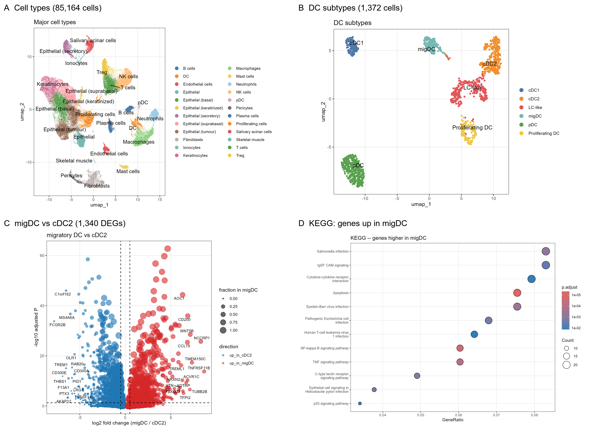

# OSCC dendritic-cell atlas

**A reproducible single-cell re-analysis of oral squamous cell carcinoma (OSCC) dendritic cells**




*(A) 85,164 个细胞的注释图谱；(B) 1,372 个 DC 的 6 个亚型；(C) cDC2 vs 迁移型 DC 的差异基因；(D) 迁移型 DC 上调基因的 KEGG 富集。*

---

## 这个仓库是什么

对一个既有的口腔癌树突状细胞（DC）单细胞分析的**重建版**。

原有分析的链条存在多处硬伤（脚本无法运行、注释参考集被破坏、富集方向混在一起、
拟时序根节点靠鼠标点选）。
本仓库不做"修补"，而是**从 GEO 原始 UMI 矩阵重跑整条流程**，并用工程化的方式组织：

- 一条命令跑完（`./run_all.sh` 或 `make all`），中间产物全部落盘、可检查；
- 每个参数只定义一次（`R/00_setup.R` 的 `PARAMS`），脚本里没有魔法数字；
- 每张图、每个结论都能追溯到 `results/tables/` 里的一个文件；
- 明确写下哪些结论**站不住**（[`docs/limitations.md`](docs/limitations.md)）。

## 一句话结论

> 在 8 例 OSCC 患者、10 个 10x 文库、**85,164 个细胞**中，树突状细胞占 **2.2%（1,872 个）**；
> DC 可分为 **6 个可解释亚型**——cDC1（124）、cDC2（310）、LC-like（286）、
> 迁移型 DC/mregDC（158）、pDC（355）、增殖型 DC（139），另排除 500 个低质量细胞。
> cDC2 → migDC 构成一条**转录成熟轴**（*CCR7*、*LAMP3*、*CCL19*、*CD274*、*IDO1* 上调，
> *CD1C*、*CLEC10A* 下调），两群之间 **1,340 个差异基因**，NF-κB 活性沿该轴升高。
> 原分析关于"cDC2 富集吞噬体/结核病通路"的观察被复现；
> 但"CLEC10A → IDO1 → 色氨酸代谢"的假说与数据方向相反，已被否定。

*（完整结果、图表与原分析逐条对照见 [`report/report.md`](report/report.md)）*

## 仓库结构

```
oscc-dc-atlas/
├── R/                        # 分析脚本，按编号顺序执行
│   ├── 00_setup.R            #   路径、参数、工具函数（唯一参数来源）
│   ├── 01_load_qc.R          #   读取 counts → 基因 ID 映射 → QC → 去双细胞 → 合并
│   ├── 02_integrate_cluster.R #   标准化 → HVG → PCA → Harmony → Leiden → UMAP
│   ├── 03_annotate_major.R   #   SingleR ×3 + marker → 主细胞类型
│   ├── 04_dc_subset.R        #   DC 亚群重聚类
│   ├── 05_dc_annotate_de.R   #   DC 亚型注释 + 差异分析
│   ├── 06_enrichment.R       #   GO / KEGG（分方向）+ GSEA
│   ├── 07_trajectory.R       #   slingshot 拟时序
│   ├── 08_tf_activity.R      #   decoupleR TF 活性
│   ├── 09_composition.R      #   DC 浸润与亚型构成
│   └── 10_qc_figure.R        #   QC 图
├── config/                   # 可编辑的注释表（cluster → cell type）
├── data/                     # 数据放置说明（原始数据不进 git）
├── results/
│   ├── figures/              # 所有图（PNG 300dpi + PDF）
│   ├── tables/               # 所有数字
│   ├── objects/              # 中间 Seurat 对象（不进 git）
│   └── logs/                 # 每次运行的完整日志（不进 git）
├── docs/                     # 方法、数据来源、体检报告、局限性
├── report/                   # 面向读者的结果报告
└── Makefile
```

## 快速开始

```bash
# 1. 环境（R >= 4.5）
Rscript -e 'install.packages("BiocManager"); BiocManager::install(c(
  "Seurat","harmony","SingleR","celldex","scDblFinder","clusterProfiler",
  "org.Hs.eg.db","fgsea","slingshot","decoupleR","msigdbr"))'

# 2. 数据：把 10 个 *_seurat.rds 放进 data/raw/<GSE>/（见 data/README.md）

# 3. 一键运行（两种方式，任选其一）
./run_all.sh                 # 不依赖 make；自动寻找 Rscript（Windows 也可用）
make all                     # 有 make 的环境

./run_all.sh 05 06           # 只跑某几步
```

单步运行：`Rscript R/05_dc_annotate_de.R`。
全流程约 35–45 分钟（16 核 / 32 GB，Windows 实测）。

> ⚠️ **改了上游参数请重跑注释**：`config/annotation_major.csv` 与
> `config/annotation_dc.csv` 里的 cluster 编号绑定于当前这次聚类结果。
> 如果你改了 QC/整合/分辨率，需要看新的 `03_cluster_markers.csv` 与
> `04_dc_marker_dotplot.png`，更新这两个表，并删除 `results/tables/03_cluster_markers.csv`、
> `03_singler_labels.csv` 以强制重算。

## 数据

| GEO | 样本 | 说明 |
|---|---|---|
| [GSE172577](https://www.ncbi.nlm.nih.gov/geo/query/acc.cgi?acc=GSE172577) | 6 | 舌部 OSCC 原发灶（原文关注 TCF7⁺ T 细胞 / TLS） |
| [GSE193766](https://www.ncbi.nlm.nih.gov/geo/query/acc.cgi?acc=GSE193766) | 4（2 癌 + 2 癌旁） | 口腔癌及配对正常组织（原文关注 γδT17） |

两套数据均为公开去标识化数据，许可与出处见 [`docs/data_provenance.md`](docs/data_provenance.md)。

## 文档

| 文件 | 内容 |
|---|---|
| [`docs/methods.md`](docs/methods.md) | 每个参数的选择理由 |
| [`docs/data_provenance.md`](docs/data_provenance.md) | 数据来源、文件取舍、校验和 |
| [`docs/limitations.md`](docs/limitations.md) | 这个项目**不能**回答什么，以及为什么 |
| [`docs/sessionInfo.txt`](docs/sessionInfo.txt) | 软件版本 |

## 引用

- Peng Y. *et al.* Single-cell profiling of tumor-infiltrating TCF7⁺ T cells … *Oral Oncol* 2021. PMID 34044317
- Chen X. *et al.* Differential metabolic requirement governed by c-Maf … *Sci Adv* 2022. PMID 35613277

## License

代码 MIT；图表 CC-BY-4.0。
