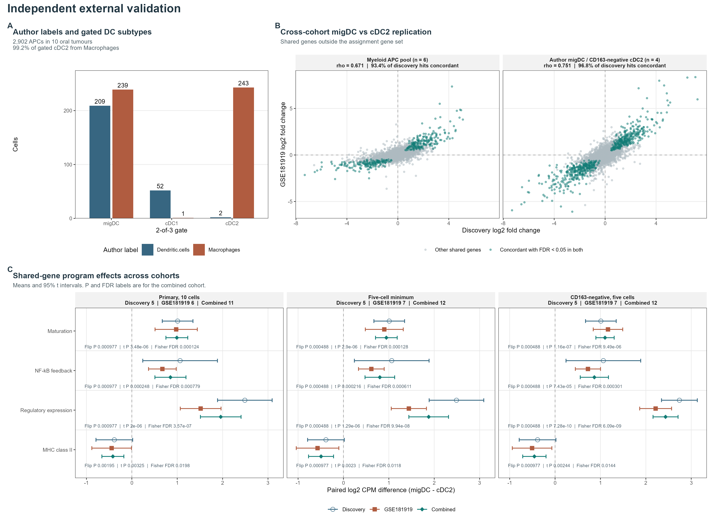

# OSCC dendritic-cell atlas

口腔鳞状细胞癌（OSCC）的树突状细胞图谱、患者配对表达分析、独立队列验证和肿瘤微环境共变。

## 主要发现

- 发现图谱覆盖 8 位患者、10 个文库、85,164 个质控合格的细胞和 1,372 个保留 DC。5 位肿瘤患者的 migDC–cDC2 配对主模型检验了 4,151 个基因，检出 933 个 FDR < 0.05 的基因。 [图谱构成](results/tables/09_dc_fraction_by_sample.csv) · [主模型](results/tables/11_sensitivity.csv)
- 排除分型基因后，4 个表达程序均可估计。Regulatory expression、Maturation 和 NF-κB feedback 的平均配对差分别为 +2.74、+1.01 和 +1.06 log₂ CPM，配对 *t* P 及定向 fry FDR 均 < 0.05。广义 Hallmark 炎症反应偏向 cDC2（CAMERA q = 0.00671）。 [程序统计](results/tables/11_program_summary.csv) · [CAMERA](results/tables/11_paired_hallmark_camera.csv)
- *IDO1* 在 migDC 和 cDC1 中相对 cDC2 较高。LC-like–cDC2 的 *IDO1* 效应为 +0.24 log₂ fold change（FDR = 0.752）。保留 DC *CCL17* 与 Treg *CCR4* 在原发肿瘤患者间共变（ρ = 0.93，FDR = 0.0362）。 [谱系比较](results/tables/11_panel_model_results.csv) · [TME 共变](results/tables/13_tme_ligand_receptor_correlations.csv)
- GSE181919 中，243/245（99.2%）个门控 cDC2 来自作者的 `Macrophages` 类。髓系 APC 主模型纳入 6 位患者（ρ = 0.671，共享发现显著基因同向率 93.4%），5 细胞门槛纳入 7 位（ρ = 0.679，同向率 94.8%）。4 位患者的混合敏感性对照为 ρ = 0.751、同向率 96.8%。三个正向程序的双队列联合方向一致性为 11/11 和 12/12，双侧符号翻转 P 分别为 9.77 × 10⁻⁴ 和 4.88 × 10⁻⁴。 [分类审计](results/tables/12_classification.csv) · [跨队列结果](results/tables/12_cross_cohort_summary.csv) · [联合程序统计](results/tables/12_combined_program_summary.csv)

GSE193766 的两对肿瘤–癌旁标签已按 GEO 文库编号纠正。配对组成按患者作描述性展示。 [配对组织表](results/tables/09_paired_tissue_descriptive.csv) · [数据溯源](docs/data_provenance.md)

## 文稿与主图

| 文件 | 内容 |
|---|---|
| [英文论文](report/manuscript.md) | IMRaD 文稿、五张主图及图注 |
| [中文结果报告](report/report.md) | 数据、关键统计及证据边界 |
| [技术方法](docs/methods.md) | 图谱、配对模型、程序检验、外部验证和 TME |
| [数据溯源](docs/data_provenance.md) | GEO 文库映射和输入校验 |
| [Fig1](results/figures/Fig1_discovery_atlas.png) · [PDF](results/figures/Fig1_discovery_atlas.pdf) | 发现图谱、DC 亚型和配对组织 |
| [Fig2](results/figures/Fig2_pseudobulk_de_and_robustness.png) · [PDF](results/figures/Fig2_pseudobulk_de_and_robustness.pdf) | 患者配对差异表达和稳健性 |
| [Fig3](results/figures/Fig3_programs_and_inflammation_paradox.png) · [PDF](results/figures/Fig3_programs_and_inflammation_paradox.pdf) | 表达程序和炎症通路 |
| [Fig4](results/figures/Fig4_lineage_and_tme_context.png) · [PDF](results/figures/Fig4_lineage_and_tme_context.pdf) | LC-like 谱系参照和 TME |
| [Fig5](results/figures/Fig5_external_validation.png) · [PDF](results/figures/Fig5_external_validation.pdf) | GSE181919 独立验证和联合结果 |

## 复现

在仓库根目录运行。主模型复算使用保存的整数 UMI 汇总和文库映射，所需的主要 Bioconductor 包为 edgeR 和 statmod。 [聚合计数](results/tables/11_primary_pseudobulk_counts.tsv.gz) · [文库映射](results/tables/11_primary_pseudobulk_libraries.csv) · [主模型复算脚本](R/verify_primary.R)

~~~bash
Rscript R/verify_primary.R
~~~

默认 `./run_all.sh` 构建发现图谱、配对模型和 TME 结果。从已审核的图谱对象重算本文结果时，把 GSE181919 元数据与真实 UMI 矩阵放入 `data/raw/GSE181919/` 并执行以下命令。阶段 12 提取和缓存髓系 APC，阶段 13 重算 TME，阶段 14 输出五张主图，`verify_all` 执行全链路审计。 [数据与依赖准备](data/README.md) · [外部验证脚本](R/12_external_validation.R) · [TME 脚本](R/13_tme_covariation.R) · [主图脚本](R/14_manuscript_figures.R) · [全链路审计脚本](R/99_verify_all.R)

~~~bash
./run_all.sh 09 11 12 13 14 verify_all
~~~

已有最新结果时，可直接审计 Stage 09、11–14 的证据、图件及文档链接。脚本还运行主模型复算，并检查真实外部输入和已生成的稀疏缓存。 [发现队列运行环境](results/tables/11_sessionInfo.txt) · [外部队列运行环境](results/tables/12_sessionInfo.txt)

~~~bash
Rscript R/99_verify_all.R
~~~

~~~powershell
& 'C:/Program Files/R/R-4.6.2/bin/Rscript.exe' R/99_verify_all.R
~~~

## 数据和许可

| GEO | 分析范围 |
|---|---|
| [GSE172577](https://www.ncbi.nlm.nih.gov/geo/query/acc.cgi?acc=GSE172577) | 6 个原发口腔舌癌文库，用于发现图谱和患者内比较。 |
| [GSE193766](https://www.ncbi.nlm.nih.gov/geo/query/acc.cgi?acc=GSE193766) | 两对原发肿瘤及癌旁组织，用于发现图谱和配对构成描述。 |
| [GSE181919](https://www.ncbi.nlm.nih.gov/geo/query/acc.cgi?acc=GSE181919) | 10 个入选原发口腔肿瘤，使用真实 UMI 矩阵进行髓系 APC 分型和独立表达验证。 |

[发现队列样本](results/tables/09_dc_fraction_by_sample.csv) · [外部队列样本](results/tables/12_cohort_inventory.csv) · [外部文件指纹](results/tables/12_inputs.csv)

代码依 MIT 许可发布。项目生成图表按 CC BY 4.0 许可使用。源数据遵循各数据集的数据使用声明。
