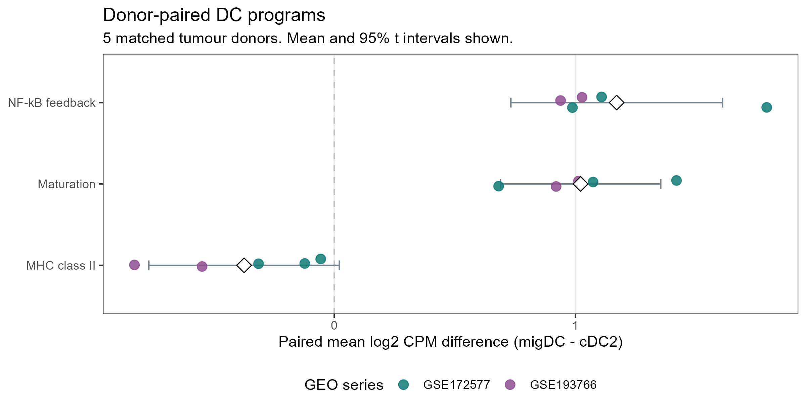

# OSCC dendritic-cell atlas

口腔鳞状细胞癌（OSCC）树突状细胞的单细胞图谱、患者配对统计分析与外部验证流程。

## 主要结果

发现图谱由 8 位患者、10 个 10x 文库的 85,164 个细胞组成。初筛获得 1,872 个 DC 候选细胞，亚群质控后保留 1,372 个。主分析在 5 位同时具有足量迁移型 DC（migDC）和 cDC2 的原发肿瘤患者内配对，检验了 1,556 个基因，其中 457 个达到 FDR < 0.05。

5 位患者的成熟相关基因组和 NF-κB 反馈基因组在 migDC 中方向一致。较宽的 Hallmark 炎症反应基因集偏向 cDC2，Hallmark TNF–NF-κB 基因集未达到 FDR 阈值。*IDO1* 在 migDC 和 cDC1 中均高于 cDC2。该结果来自转录表达，相关功能需独立验证。

GSE193766 的原始图谱曾对调两个患者的肿瘤与癌旁标签。本版按 GEO 的 N1/T1 和 N2/T2 纠正样本表、组织分组图和汇总表。两对组织的 DC 比例变化方向各异，报告描述性结果。

## 复现

安装主模型所需的 Bioconductor 软件后，可以用仓库内的 10 个患者 × 亚型汇总样本复算主结果。复算数据包含每组至少 10 个细胞，不包含单细胞条形码。

~~~bash
Rscript -e 'install.packages("BiocManager"); BiocManager::install(c("edgeR","statmod"))'
Rscript R/verify_primary.R
~~~

重建发现图谱需要数据准备和更多依赖。运行环境、输入格式及软件版本见[数据准备](data/README.md)和[运行环境](results/tables/11_sessionInfo.txt)。

~~~bash
./run_all.sh                 # 发现图谱和患者配对分析，阶段 01–11
./run_all.sh 09 11           # 从已建图谱更新组成和患者配对结果
Rscript R/12_external_validation.R --inventory-only
./run_all.sh 12              # 下载 GSE181919 计数矩阵后运行表达验证
~~~

修改质控、整合或聚类参数后，需要按新的聚类结果审核 `config/annotation_major.csv` 与 `config/annotation_dc.csv`。主分析使用旧图谱的整数 UMI 计数及已审核的亚型标签，组织分组从 [GEO 样本表](config/samples.csv)重新匹配。

## 数据与证据

| GEO | 样本 | 已使用的数据 |
|---|---:|---|
| [GSE172577](https://www.ncbi.nlm.nih.gov/geo/query/acc.cgi?acc=GSE172577) | 6 个原发肿瘤 | 发现图谱和患者内比较 |
| [GSE193766](https://www.ncbi.nlm.nih.gov/geo/query/acc.cgi?acc=GSE193766) | 2 对原发肿瘤和癌旁 | 发现图谱、肿瘤内比较和配对组成描述 |
| [GSE181919](https://www.ncbi.nlm.nih.gov/geo/query/acc.cgi?acc=GSE181919) | 10 个原发口腔肿瘤满足解剖部位条件 | 已核实 10,397 个细胞和 688 个作者标注的 DC。表达复现等待 GEO UMI 矩阵 |

| 文件 | 内容 |
|---|---|
| [结果报告](report/report.md) | 中文结果、图表与证据边界 |
| [英文论文草稿](report/manuscript.md) | 引言、方法、结果和讨论 |
| [方法](docs/methods.md) | 图谱构建、患者配对及敏感性分析 |
| [数据溯源](docs/data_provenance.md) | GEO 标题、原始记录和文件校验 |
| [主差异表达结果](results/tables/11_de_migDC_vs_cDC2.csv) | 效应值、FDR 和逐患者剔除结果 |
| [GSE181919 候选样本清单](results/tables/12_cohort_inventory.csv) | 数据作者的细胞类型及口腔肿瘤样本统计 |

代码依 MIT 许可发布。项目生成图表可按 CC BY 4.0 使用。源数据遵循各数据集的数据使用声明。
