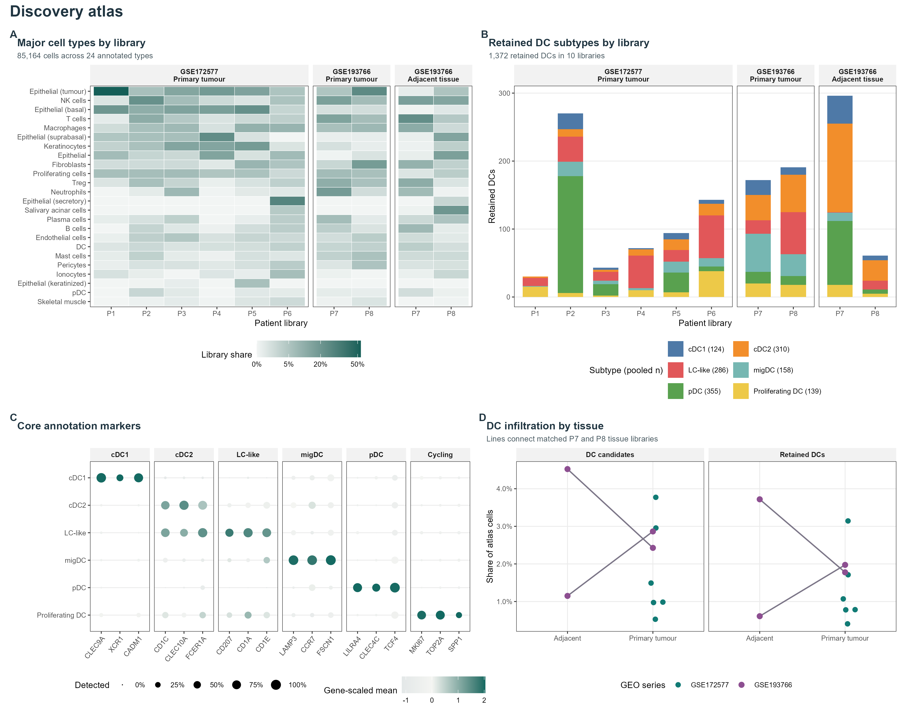
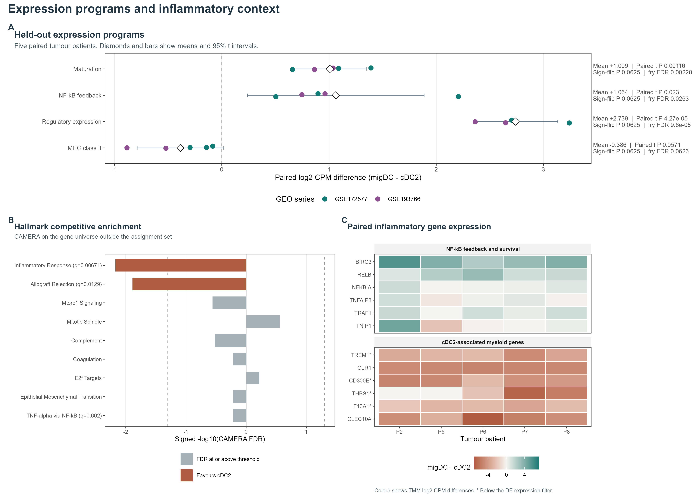

# Maturation and regulatory expression in migratory dendritic cells of oral squamous cell carcinoma across patient-paired cohorts

## Abstract

**Background**

Migratory dendritic cells (migDCs) in tumours express maturation and immunoregulatory genes. In oral squamous cell carcinoma (OSCC), it remains unclear how these features vary across patients, conventional dendritic cells (DCs) and mucosal Langerhans-like (LC-like) states.

**Methods**

We analysed 85,164 cells from 10 libraries representing eight patients. We compared migDC with conventional type 2 DCs (cDC2) using donor-paired pseudobulk models, tested expression programs that exclude assignment genes, and examined covariation across tumour immune populations. We repeated the expression analysis in independently collected GSE181919 after gating DC states within the broad myeloid antigen-presenting-cell (APC) pool. [Discovery libraries](../results/tables/09_dc_fraction_by_sample.csv)

**Results**

The discovery fit tested 4,151 genes in five paired tumours and identified 933 at a false discovery rate (FDR) < 0.05. All four held-out programs were estimable. Mean migDC–cDC2 differences were +2.74 log₂ counts per million (CPM) for Regulatory expression, +1.01 for Maturation and +1.06 for NF-κB feedback (each paired *t* P < 0.05 and directional fry FDR < 0.05). The Hallmark inflammatory response favoured cDC2 (CAMERA q = 0.00671). *IDO1* was higher in migDC and cDC1 relative to cDC2, with little difference between LC-like and cDC2. Retained-DC *CCL17* covaried with regulatory T-cell (Treg) *CCR4* (ρ = 0.93, FDR = 0.0362). External APC-pool models included six to seven paired patients (ρ = 0.671–0.679, 93.4%–94.8% concordance among shared discovery hits). A four-patient hybrid sensitivity reached ρ = 0.751 and 96.8% concordance. Maturation, NF-κB feedback and Regulatory expression were higher in migDC in 11/11 and 12/12 combined patients at the respective APC-pool thresholds (per-program exact sign-flip P = 9.77 × 10⁻⁴ and 4.88 × 10⁻⁴). [Discovery](../results/tables/11_sensitivity.csv) · [Programs](../results/tables/11_program_summary.csv) · [CAMERA](../results/tables/11_paired_hallmark_camera.csv) · [Lineages](../results/tables/11_panel_model_results.csv) · [Covariation](../results/tables/13_tme_ligand_receptor_correlations.csv) · [Replication](../results/tables/12_cross_cohort_summary.csv) · [Combined tests](../results/tables/12_combined_program_summary.csv)

**Conclusions**

Across OSCC cohorts, a migratory DC state couples maturation with regulatory and feedback transcription. Inflammatory and regulatory results depended on the genes tested and the comparator state.

**Keywords**

Oral squamous cell carcinoma, dendritic cells, pseudobulk, Langerhans-like cells, tumour microenvironment, external validation

## 1. Introduction

Tumour-associated DCs connect antigen capture and presentation with the recruitment and activation of lymphocytes. Studies of lung tumours identified mature DCs enriched in immunoregulatory molecules (mregDCs), in which migration and maturation genes occur alongside ligands such as *CD274*, *PDCD1LG2* and *CD200*. This program was observed across conventional DC lineages, raising the question of whether maturation and regulatory expression also covary within patients with OSCC. [Maier et al.](https://pubmed.ncbi.nlm.nih.gov/32269339/)

The oral mucosa contains langerin-expressing antigen-presenting cells in an epithelium continually exposed to microbial and environmental antigens. A *CD207*/*CD1A*-expressing LC-like population therefore provides a mucosa-relevant comparator alongside cDC1 and cDC2. A distinct question concerns inflammatory direction. An NF-κB-responsive feedback or survival transcript can increase during DC maturation even when a broad inflammatory gene set favours a conventional myeloid comparator. The biological interpretation depends on the genes, the test and the cell states compared. [Human oral mucosal langerin-expressing cells](https://pubmed.ncbi.nlm.nih.gov/34935212/) · [NF-κB feedback kinetics](https://pubmed.ncbi.nlm.nih.gov/18676814/)

Rare DC states can be represented by many cells from few patients. Cell-level tests describe cluster differences, while inference across tumours requires accounting for dependence within patients. We used within-tumour contrasts to test the coupling of maturation and regulation, resolve the direction of broad inflammatory expression, examine ligand and receptor covariation, and evaluate replication in an independently collected cohort. [Squair et al.](https://doi.org/10.1038/s41467-021-25960-2)

## 2. Materials and methods

### 2.1. Discovery cohorts, annotation and composition

This study is a secondary analysis of publicly deposited, de-identified single-cell RNA sequencing data. The discovery atlas comprised six primary oral-tongue tumours from GSE172577 and two matched primary tumour–adjacent tissue pairs from GSE193766. We reconciled tissue labels by GEO accession, correcting the reversed assignments in both GSE193766 pairs. The analysis reused the reviewed count and annotation snapshots. Library-based Harmony integration allowed the tissue reassignment to be applied to the metadata and tissue-stratified results. [Discovery library table](../results/tables/09_dc_fraction_by_sample.csv) · [Data provenance](../docs/data_provenance.md)

The atlas workflow used per-library quality control and doublet removal, harmonised gene symbols, library-based embedding integration, Leiden clustering, and marker- and reference-guided annotation. RNA-layer unique molecular identifier (UMI) counts were preserved for aggregation. The candidate DC pool included the broad DC and plasmacytoid DC (pDC) labels. Reclustering and review yielded cDC1, cDC2, LC-like, migDC, pDC and proliferating DC. Candidate and retained DC fractions use all quality-controlled cells in the library as the denominator. Retained-state proportions use all retained DCs. We described tumour–adjacent differences within each matched patient. [Technical methods](../docs/methods.md) · [Subtype assignments](../config/annotation_dc.csv)

### 2.2. Donor-paired pseudobulk models and sensitivity analyses

We summed integer RNA counts by tumour library and DC state. The primary migDC–cDC2 model required at least 10 cells per state within a tumour and at least four qualifying patients. We used `edgeR::filterByExpr` by subtype with `min.count = 3` and `min.total.count = 10` to accommodate sparse DC aggregates. Library sizes were recalculated after filtering, followed by trimmed mean of M values (TMM) normalisation. The robust negative-binomial quasi-likelihood fit used `~ patient + dc_subtype`. The subtype coefficient was tested with a quasi-likelihood F test and Benjamini–Hochberg (BH) adjustment across genes in each contrast. Effects are reported as the log₂ fold change of the first named state relative to the second. [Model settings and eligibility](../results/tables/11_sensitivity.csv) · [edgeR](https://bioconductor.org/packages/edgeR)

The secondary models compared migDC with cDC1 and cDC1 with cDC2 at a five-cell minimum per state. The mucosal contrasts compared migDC with LC-like and LC-like with cDC2 at a 10-cell minimum. We refitted the primary comparison after omitting each patient, at alternative cell thresholds, with TMMwsp normalisation and under the `strict_filter_min10` expression filter (`min.count = 10`, `min.total.count = 15`). To assess cell-number imbalance, we repeatedly sampled the larger state down to the smaller state's cell count in each eligible tumour and recalculated TMM-based paired scores over the primary tested genes. We compared the primary results with the archived cell-level Wilcoxon estimates over genes that had results from both methods. [Model sensitivities](../results/tables/11_sensitivity.csv) · [Equal-cell subsampling](../results/tables/11_balanced_cell_sensitivity.csv)

For the alternative labels, we reclassified cells from the original cDC1, cDC2 and migDC pool. A subtype call required nonzero UMI counts for at least two of its three gate genes and passage of a single gate. The panels were *CLEC9A/XCR1/CADM1* for cDC1, *CD1C/CLEC10A/FCER1A* for cDC2 and *LAMP3/CCR7/FSCN1* for migDC. We recorded ambiguous and unassigned cells and assessed the reclassification at five- and 10-cell minima. Rank comparisons with the main model excluded both the listed discovery assignment markers and gate genes. [Gate definitions](../config/external_dc_gates.csv) · [Gate sensitivity](../results/tables/11_marker_gate_sensitivity.csv)

### 2.3. Held-out expression programs and competitive pathways

The predefined Maturation, NF-κB feedback, Regulatory expression and MHC class II panels excluded the listed discovery assignment and gate genes. Each program required at least 60% of its targets in the count-filtered gene set. We calculated a patient's score as the mean migDC–cDC2 difference in TMM log₂ counts per million (CPM, prior count 1) across the retained genes. Patient scores contributed equally to the mean, with a 95% *t* interval. We tested the scores using a two-sided exact sign-flip test of the absolute sum and a two-sided one-sample *t* test of paired differences against zero. Separately, `limma::fry` applied self-contained rotation-based gene-set inference to the filtered log₂ CPM matrix with the same paired design and subtype contrast. We report its directional P and FDR and retain the mixed-direction results in the evidence table. BH adjustment is applied within each contrast and test family. [Program definitions](../config/dc_programs.csv) · [Donor scores](../results/tables/11_program_donor_effects.csv) · [fry results](../results/tables/11_program_fry.csv) · [limma](https://bioconductor.org/packages/limma)

We also ran the program tests on the gate-based labels. The expanded Regulatory expression (incl. CD274/IDO1) panel could include *CD274* and *IDO1* because neither gene contributed to the gates. CAMERA tested MSigDB Hallmark sets against the rest of the tested universe after excluding discovery assignment and gate genes. It used the primary paired design, preserved TMM effective library sizes and retained sets with at least 10 measurable members. Hallmark FDRs were adjusted across the tested sets. [Gate-based program results](../results/tables/11_marker_gate_programs.csv) · [CAMERA results](../results/tables/11_paired_hallmark_camera.csv) · [Wu and Smyth](https://pubmed.ncbi.nlm.nih.gov/22638577/)

### 2.4. Patient-level tumour microenvironment covariation

Stage 13 quantified the tumour microenvironment (TME) using immune-cell and retained-DC composition by library. The immune denominator included T cells, Tregs, NK cells, B and plasma cells, macrophages, DCs, pDCs, mast cells and neutrophils. The T/NK denominator included T cells, Tregs and NK cells. We summed counts separately by population and tumour for retained DCs, migDC, Tregs, T cells and macrophages. A migDC expression profile required at least three observed cells. We estimated TMM factors across available libraries within each population on its full transcriptome and extracted log₂ CPM with prior count 1. The T-cell inhibitory module averaged the log₂ CPM of *PDCD1*, *CTLA4*, *TIGIT*, *LAG3* and *HAVCR2*. [Composition](../results/tables/13_tme_cell_proportions.csv) · [Patient profiles](../results/tables/13_tme_donor_profiles.csv)

We tested predefined composition, ligand–receptor and cell-state axes, including correlations of the primary and three-cell sensitivity migDC–cDC2 Maturation, Regulatory expression and NF-κB feedback scores with Treg representation, Treg *CCR4*, Treg *FOXP3* and the T-cell inhibitory module. Across primary tumours we used complete pairs and a two-sided Spearman test with `exact = FALSE`, requiring at least three complete patients and variation in both features. We applied BH adjustment to all testable axes together. [TME analysis](../R/13_tme_covariation.R) · [Test results](../results/tables/13_tme_ligand_receptor_correlations.csv)

### 2.5. Independent external validation and cross-cohort pooling

Stage 12 selected GSE181919 primary oral-cavity tumours (`tissue.type == "CA"`, `subsite == "OC"`). We extracted original UMI columns for both author categories, `Dendritic.cells` and `Macrophages`. Selected barcodes were matched uniquely and exactly after harmonising a terminal dot or hyphen before the numeric suffix. We validated nonnegative integer counts and cached the sparse matrix against source byte size, MD5 and barcode list. We applied the same two-of-three gates as in discovery. One-marker calls were included in the classification audit, while modelled contrasts used the two-of-three rule. [Choi et al.](https://pubmed.ncbi.nlm.nih.gov/36828832/) · [GEO series](https://www.ncbi.nlm.nih.gov/geo/query/acc.cgi?acc=GSE181919) · [Input ledger](../results/tables/12_inputs.csv) · [Classification](../results/tables/12_classification.csv)

We fitted paired migDC–cDC2 contrasts in the full myeloid APC pool and in the subset with zero detected *CD163* UMIs, each at the 10- and five-cell thresholds. The 10-cell hybrid restricted migDC to `Dendritic.cells` and selected cDC2 from the CD163-negative myeloid pool. Author-DC-only migDC–cDC2 controls used the same thresholds. We also evaluated migDC–cDC1 within the author DC cluster at the three-cell threshold and migDC–cDC1 and cDC1–cDC2 in the full pool at the five-cell threshold. The four-donor fitting minimum, count filtering, model and program tests matched discovery, with the expanded regulatory panel evaluated on the external gate labels. We compared log₂ fold-change ranks across shared, testable genes after excluding assignment and gate genes. Direction concordance among discovery hits used the subset of those shared genes with discovery FDR < 0.05. [External sensitivities](../results/tables/12_sensitivity.csv) · [Gene concordance](../results/tables/12_cross_cohort_summary.csv) · [External program tests](../results/tables/12_program_summary.csv)

For each fitted migDC–cDC2 external setting, we intersected its analysed program genes with those from the discovery primary fit and recomputed donor scores on the same shared genes in both cohorts. We pooled the independent patients and calculated unweighted mean effects, 95% *t* intervals, direction counts, exact sign-flip and paired *t* tests with BH adjustment. Fisher's method combined the two cohort-specific directional fry P values using a chi-square reference with four degrees of freedom, followed by BH adjustment over the four held-out programs per model. Fisher's inputs came from each cohort's eligible program genes, while the pooled effect used only shared genes. We recorded the fry directions separately. [Shared donor scores](../results/tables/12_shared_program_donor_effects.csv) · [Combined program analysis](../results/tables/12_combined_program_summary.csv)

## 3. Results

### 3.1. Discovery atlas, DC heterogeneity, and matched-tissue composition

The 10 libraries contained 85,164 quality-controlled cells spanning 24 major annotations. Of 1,872 candidate DCs (2.20% of atlas cells), 1,372 (1.61%) passed DC subtype review. The retained population contained 124 cDC1, 310 cDC2, 286 LC-like, 158 migDC, 355 pDC and 139 proliferating DC cells. The LC-like state accounted for 20.8% of retained DCs and expressed *CD207*, *CD1A* and *CD1E*. The migDC cluster expressed the migration markers *LAMP3* and *CCR7*. [Atlas cell counts](../results/tables/03_celltype_by_sample.csv) · [Library DC fractions](../results/tables/09_dc_fraction_by_sample.csv) · [Pooled subtypes](../results/tables/09_dc_subtype_pooled.csv)

After correction of the GSE193766 tissue assignments, retained DCs as a fraction of all atlas cells changed by −1.94 percentage points in P7 and +1.37 in P8 (tumour minus adjacent). The patient-specific directions also differed for the broader DC candidate fractions. The two pairs provide a descriptive view of composition. [Matched tissues](../results/tables/09_paired_tissue_descriptive.csv)

**Figure 1. Discovery atlas and tissue composition.** **A**, heatmap of 24 major annotations in 10 libraries, grouped by GEO series and tissue. Colour represents the fraction of all atlas cells in a library. **B**, retained DC counts by subtype and library, with pooled subtype totals in the legend. **C**, core DC annotation markers. Dot size encodes detection frequency and colour encodes the gene-scaled mean expression of each subtype. **D**, all-cell fractions of candidate DCs and retained DCs. Lines connect the corrected GSE193766 tumour–adjacent pairs P7 and P8. Unconnected points represent unmatched primary tumours. [PDF](../results/figures/Fig1_discovery_atlas.pdf)

### 3.2. Donor-paired differential expression and methodological robustness

Five primary tumours met the 10-cell threshold per state. Of 4,151 tested genes, 933 passed FDR < 0.05. The paired model estimated migDC enrichment of *LAMP3*, *CCR7* and *CCL19*, which informed the original annotation, and of the held-out maturation marker *CD83* (log₂ fold change +0.70, FDR 0.00430). The sparse regulatory genes *PDCD1LG2* and *CD200* were testable, with log₂ fold changes of +2.73 and +6.46 and gene-level FDRs of 2.88 × 10⁻⁴ and 1.11 × 10⁻⁶, respectively. [Primary DE](../results/tables/11_de_migDC_vs_cDC2.csv) · [Panel models](../results/tables/11_panel_model_results.csv)

On 3,092 genes with both estimates, 296 met the adjusted significance threshold only in the cell-level analysis and 199 only in the donor-paired analysis. The two tests use different sampling units, filters and adjustment procedures. Leave-one-patient-out comparisons gave shared-gene ρ = 0.932–0.992. The three-cell minimum yielded seven patients and ρ = 0.983. The five-cell minimum retained the primary five patients, whereas the 15- and 20-cell settings fell below the fitting minimum. The TMMwsp and stringent expression-filter fits each gave shared-gene ρ above 0.9999. Under marker-gate reassignment, four patients contributed to the five-cell model and the non-assignment shared-gene correlation was ρ = 0.926. Three patients met the 10-cell gate threshold. [Matched cell-level and paired results](../results/tables/11_de_migDC_vs_cDC2.csv) · [Leave-one-out](../results/tables/11_leave_one_donor_out.csv) · [Threshold, filtering and normalisation](../results/tables/11_sensitivity.csv) · [Marker-gate comparison](../results/tables/11_marker_gate_sensitivity.csv)

**Figure 2. Donor-paired differential expression and robustness.** **A**, primary migDC versus cDC2 volcano plot for 4,151 genes. Positive effects favour migDC. The horizontal threshold denotes FDR < 0.05, and labels identify selected maturation, migration, regulatory and cDC2 markers. *CD300E* fell below the expression filter. **B**, adjusted significance (−log₁₀ scale) and log₂ fold change for genes with both a cell-level Wilcoxon and patient-paired edgeR estimate. Colour identifies which results meet the method-specific adjusted significance threshold. **C**, Spearman correlation of log₂ fold changes with the primary model over shared tested genes. Rows show donor omission, cell support, normalisation, expression filtering and gate-based reassignment. Row labels give the number of eligible patients, and rows below the fitting minimum are identified. [PDF](../results/figures/Fig2_pseudobulk_de_and_robustness.pdf)

### 3.3. Held-out transcriptional programs and resolution of the inflammatory paradox

All four held-out programs met coverage in the main comparison. Maturation, NF-κB feedback and Regulatory expression were higher in migDC in each of the five patients and in all 40 equal-cell subsampling runs. The exact sign-flip P was 0.0625 for each primary program, with BH FDR 0.0625. The paired *t* and directional fry tests supported the three positive programs. The directional MHC class II result was weaker (paired *t* P = 0.0571, fry FDR = 0.0626), with evidence of mixed-direction changes within that set (mixed fry FDR = 0.0262). [Program summary](../results/tables/11_program_summary.csv) · [fry results](../results/tables/11_program_fry.csv) · [Subsampling](../results/tables/11_balanced_cell_sensitivity.csv)

| Held-out program | Genes retained / target | Mean paired Δ log₂ CPM (95% *t* CI) | Paired *t* P | Paired *t* FDR | Directional fry FDR |
|---|---:|---:|---:|---:|---:|
| Maturation | 5/6 | +1.01 (+0.67, +1.35) | 0.00116 | 0.00232 | 0.00228 |
| NF-κB feedback | 7/7 | +1.06 (+0.24, +1.89) | 0.0230 | 0.0306 | 0.0263 |
| Regulatory expression | 6/7 | +2.74 (+2.34, +3.13) | 4.27 × 10⁻⁵ | 1.71 × 10⁻⁴ | 9.60 × 10⁻⁵ |
| MHC class II | 8/8 | −0.39 (−0.79, +0.02) | 0.0571 | 0.0571 | 0.0626 |

With gate reassignment, the expanded Regulatory expression panel retained seven of nine target genes and was higher in migDC in all four paired patients. The mean difference was +4.08 log₂ CPM (paired *t* P = 1.90 × 10⁻⁴, directional fry FDR = 6.11 × 10⁻⁴). This comparison held both *CD274* and *IDO1* out of the gate used to define the states. [Marker-gate program tests](../results/tables/11_marker_gate_programs.csv)

Assignment-excluded CAMERA found relative enrichment in cDC2 for Hallmark inflammatory response (q = 0.00671) and allograft rejection (q = 0.0129). The broad TNF signalling via NF-κB set showed weak directional evidence (q = 0.602). *BIRC3*, *RELB*, *NFKBIA*, *TNFAIP3*, *TRAF1* and *TNIP1* had positive model effects, with support at gene-level FDR < 0.05 for *BIRC3*, *RELB* and *TRAF1*. *OLR1* and *CLEC10A* favoured cDC2. Figure 3C also displays descriptive paired effects for *TREM1*, *CD300E*, *THBS1* and *F13A1* from the underlying counts because these genes failed the primary expression filter. [CAMERA results](../results/tables/11_paired_hallmark_camera.csv) · [Gene effects](../results/tables/11_de_migDC_vs_cDC2.csv) · [Aggregate counts](../results/tables/11_primary_pseudobulk_counts.tsv.gz)

**Figure 3. Held-out programs and inflammatory pathway context.** **A**, each point is a patient's mean within-tumour log₂ CPM difference over retained program genes, coloured by discovery series. Diamonds are the across-patient means and bars are 95% *t* intervals. Annotations report mean effects, paired *t* and exact sign-flip P values, and directional fry FDRs. **B**, representative Hallmark CAMERA results quantified by signed −log₁₀ FDR. Positive values favour migDC and negative values favour cDC2. The competitive gene universe excludes the listed assignment and gate genes. **C**, paired log₂ CPM differences for feedback and survival genes and cDC2-associated myeloid genes in each of the five primary patients. Heatmap values use the primary TMM effective library sizes. Asterisks flag genes displayed descriptively from counts after failing the primary DE filter. [PDF](../results/figures/Fig3_programs_and_inflammation_paradox.pdf)

### 3.4. DC lineage specificity including mucosal LC-like states and TME covariation

All five discovery contrasts were supported by the same five tumours at their respective thresholds. The migDC–LC-like and LC-like–cDC2 contrasts tested 5,873 and 6,626 genes, respectively. *IDO1* was higher in migDC than cDC2 (+3.20 log₂ fold change, FDR = 6.63 × 10⁻⁹) and in cDC1 than cDC2 (+2.15, FDR = 3.55 × 10⁻⁷). It was also higher in migDC than LC-like (+2.96, FDR = 1.26 × 10⁻¹²), whereas LC-like versus cDC2 was +0.24 (FDR = 0.752). The paired models gave positive, FDR-supported migDC effects for *CD274*, *PDCD1LG2*, *CD200* and *SOCS2* against each of cDC2, cDC1 and LC-like. *CD274* and *IDO1* contributed to the original migDC annotation. The held-out *PDCD1LG2*, *CD200* and *SOCS2* effects provide complementary support. [Model summary](../results/tables/11_sensitivity.csv) · [Lineage panel](../results/tables/11_panel_model_results.csv) · [Primary DE](../results/tables/11_de_migDC_vs_cDC2.csv) · [migDC–cDC1 DE](../results/tables/11_de_migDC_vs_cDC1.csv) · [migDC–LC-like DE](../results/tables/11_de_migDC_vs_LClike.csv)

Across eight primary tumours, retained-DC *CCL17* and Treg *CCR4* had ρ = 0.93 (P = 8.63 × 10⁻⁴, FDR = 0.0362). Retained-DC *CCL19* and T-cell *CCR7* had ρ = 0.88 (P = 0.00385, FDR = 0.0809). The DC *CCL17* association was the sole axis meeting the 5% FDR threshold across 42 testable comparisons. The migDC share of retained DCs and the Treg share of T and NK cells had ρ = 0.17 (FDR = 0.998). Four three-cell Regulatory expression comparisons could not be estimated because of program coverage. [TME correlations](../results/tables/13_tme_ligand_receptor_correlations.csv) · [Donor profiles](../results/tables/13_tme_donor_profiles.csv)

**Figure 4. Lineage comparisons and immune covariation.** **A**, donor-level paired log₂ CPM differences for *IDO1*, *CD274*, *PDCD1LG2*, *CD200*, *CD83* and *TNFAIP3* across the five lineage contrasts. Diamonds show mean effects. Positive values favour the first named state and unavailable gene estimates are labelled filtered. **B**, Spearman correlations and BH FDRs for selected ligand, composition and paired-program axes from the tumour-wide test family. **C**, retained-DC *CCL17* against Treg *CCR4* and retained-DC *CCL19* against T-cell *CCR7*. Points denote tumour patients, colour denotes source series and the fitted lines are descriptive. Facet annotations report Spearman ρ, BH FDR and the available number of patients. [PDF](../results/figures/Fig4_lineage_and_tme_context.pdf)

### 3.5. Independent validation in GSE181919 and cross-cohort meta-analysis

The deposited counts covered 10,397 cells from the 10 selected oral-cavity tumours. The APC extraction used 2,902 cells, comprising 688 marked `Dendritic.cells` and 2,214 marked `Macrophages`. Under the exclusive two-of-three gates, 243 of 245 cDC2 calls (99.2%) fell in the broad `Macrophages` category. The `Dendritic.cells` category contained 209 migDC, 52 cDC1 and two cDC2 calls. The author-DC-only migDC–cDC2 controls yielded zero qualifying pairs at either threshold. Recovering cDC2 from the joint APC pool yielded six patients at the 10-cell cutoff and seven at the five-cell cutoff. [Cohort inventory](../results/tables/12_cohort_inventory.csv) · [Author-label audit](../results/tables/12_classification.csv) · [Eligibility and fitting](../results/tables/12_sensitivity.csv)

The external primary model shared 3,989 testable non-assignment genes with discovery. Log₂ fold changes had Spearman ρ = 0.671, with 823/881 (93.4%) of shared discovery hits concordant and 347 also reaching external FDR < 0.05. The five-cell APC fit gave ρ = 0.679 and 94.8% hit concordance. The CD163-negative five-cell fit gave ρ = 0.700 and 95.0% hit concordance with seven patients. The four-patient hybrid gave ρ = 0.751 and 860/888 (96.8%) hit concordance, with 618 concordant hits at external FDR < 0.05. Within the author DC class, the migDC–cDC1 contrast had six eligible patients at the three-cell minimum and yielded ρ = 0.793 and 97.3% hit concordance versus the corresponding discovery contrast. [Cross-cohort summary](../results/tables/12_cross_cohort_summary.csv) · [Shared gene estimates](../results/tables/12_cross_cohort_genes.csv)

In the six-patient external primary model, mean paired effects were +0.98 log₂ CPM for Maturation, +0.67 for NF-κB feedback and +1.52 for held-out Regulatory expression. All six patients had positive effects for each program. Each directional fry FDR was below 0.05. The expanded Regulatory expression panel showed a mean +1.92 log₂ CPM with paired *t* P = 2.33 × 10⁻⁴ and fry FDR = 4.59 × 10⁻⁴. [External program summary](../results/tables/12_program_summary.csv) · [External fry results](../results/tables/12_program_fry.csv)

After scoring the same genes in both cohorts, Maturation, NF-κB feedback and Regulatory expression were positive in 11/11 patients for primary and 12/12 for both the APC-pool and CD163-negative five-cell models. Each of the three programs had exact sign-flip P = 9.77 × 10⁻⁴ in primary and 4.88 × 10⁻⁴ in the five-cell models. In the primary joint analysis, mean effects were +0.99, +0.85 and +1.96 log₂ CPM, respectively. The pooled paired *t* P values were 3.48 × 10⁻⁶, 2.48 × 10⁻⁴ and 2.00 × 10⁻⁶, with Fisher fry FDRs of 1.24 × 10⁻⁴, 7.79 × 10⁻⁴ and 3.57 × 10⁻⁷. MHC class II had a pooled primary mean of −0.42 (95% *t* CI −0.66 to −0.18). [Shared donor effects](../results/tables/12_shared_program_donor_effects.csv) · [Joint tests](../results/tables/12_combined_program_summary.csv)

**Figure 5. Independent external validation and combined effects.** **A**, counts of migDC, cDC1 and cDC2 defined by exclusive two-of-three gates within each author category. **B**, gene-level log₂ fold changes in discovery and GSE181919 for the primary myeloid APC model and the hybrid author migDC versus CD163-negative cDC2 model. Each dot denotes a shared gene outside the listed assignment and gate genes. Coloured dots have concordant effects and FDR < 0.05 in both cohorts. Annotations give the correlation over all shared genes and concordance among shared discovery hits. **C**, cohort-specific and pooled shared-gene effects for the four held-out programs. Each symbol denotes a mean paired log₂ CPM difference, with a 95% *t* interval. The primary, five-cell APC and five-cell CD163-negative panels label cohort denominators and show pooled exact sign-flip P, paired *t* P and Fisher fry FDR for each program. [PDF](../results/figures/Fig5_external_validation.pdf)

## 4. Discussion

The apparent inflammatory paradox arises from the level at which inflammation is measured. In migDC, *NFKBIA* and *TNFAIP3* encode inducible feedback inhibitors that constrain NF-κB signalling. *TNIP1* is associated with the A20 regulatory machinery, *RELB* with the noncanonical NF-κB arm, and *BIRC3* and *TRAF1* with TNF-receptor-linked signalling and survival. Their joint transcription is compatible with a mature state that retains a response to inflammatory cues while limiting their duration or consequences. The broad inflammatory and allograft Hallmark signatures favoured cDC2 in the competitive test, in keeping with the cDC2-side expression of innate myeloid sensing or response genes represented by *TREM1*, *OLR1*, *CD300E* and *THBS1*. The data support a feedback and survival expression program, while receptor activity, feedback kinetics and survival during migration remain hypotheses for functional assays. [NF-κB temporal feedback](https://pubmed.ncbi.nlm.nih.gov/18676814/) · [A20 and ABIN](https://pubmed.ncbi.nlm.nih.gov/10385526/) · [Program results](../results/tables/11_program_summary.csv) · [CAMERA](../results/tables/11_paired_hallmark_camera.csv)

The lineage comparisons distinguish a shared response from a state-enriched regulatory profile. *IDO1* was elevated in both cDC1 and migDC relative to cDC2, and LC-like cells resembled cDC2 on this axis. The finding motivates testing which cells contribute to intratumoural tryptophan catabolism. Across the sampled comparator states, migDC showed enrichment of the checkpoint ligands *CD274* and *PDCD1LG2*, the regulatory ligand *CD200*, and the cytokine-signalling regulator *SOCS2*. The LC-like population displayed a mucosal *CD207*/*CD1A*/*CD1E* signature, giving a tissue-relevant comparator for this state specificity. The gate-based regulatory panel supports an expanded state contrast with *CD274* and *IDO1* held out of the gate. Aggregated RNA measures the subtype average and cannot establish single-cell coexpression. [Lineage panel](../results/tables/11_panel_model_results.csv) · [Gate results](../results/tables/11_marker_gate_programs.csv) · [Oral mucosal APCs](https://pubmed.ncbi.nlm.nih.gov/34935212/)

The covariation results suggest immune niches that merit spatial and protein-level study. Retained-DC *CCL17* tracked Treg *CCR4* across tumours, consistent with a chemokine axis that can guide CCR4-expressing Tregs. The *CCL19*–*CCR7* association was positive with weaker evidence after adjustment, and the composition axes offered little evidence of corresponding shifts in Treg proportions. Shared inflammation, cell mixture and series effects remain possible sources of covariance. The GSE181919 experience shows how ascertainment of rare populations depends on annotation granularity. In that cohort, 99.2% of gated cDC2 calls fell within the authors' broad `Macrophages` category. Applying explicit gates across the wider myeloid pool made donor-level comparisons feasible. Concordance in the CD163-negative and hybrid sensitivities strengthens the expression finding while leaving uncertainty about the identity of individual UMI-defined cells. [Treg chemotaxis](https://pubmed.ncbi.nlm.nih.gov/11560999/) · [TME correlations](../results/tables/13_tme_ligand_receptor_correlations.csv) · [External classification](../results/tables/12_classification.csv) · [External concordance](../results/tables/12_cross_cohort_summary.csv)

The discovery primary fit includes five paired patients, and the two tumour–adjacent pairs support descriptive composition only. The exact test has coarse P-value resolution at this sample size, while the paired *t* tests and intervals rely on the sampling behaviour of the donor differences. Alternative gates and held-out lists reduce direct reuse of label genes, but correlated genes, retrospective cell-state definitions and UMI detection limits can still influence estimates. CD163 negativity denotes zero detected RNA and can include dropout. The TME correlations use a small observational set of tumours with no direct evidence of spatial contact, ligand secretion or receptor activity. The analysis used no harmonised clinical staging or survival follow-up. RNA abundance, retained fractions and inferred states cannot establish protein function, net immunosuppression, recruitment or a direction of lineage differentiation. [Primary eligibility](../results/tables/11_sensitivity.csv) · [Paired tissues](../results/tables/09_paired_tissue_descriptive.csv)

## Data and code availability

The discovery and validation data are publicly deposited in GEO. Accession mapping, snapshot provenance, aggregate counts, model settings and the figure-generation code accompany the study. [GSE172577](https://www.ncbi.nlm.nih.gov/geo/query/acc.cgi?acc=GSE172577) · [GSE193766](https://www.ncbi.nlm.nih.gov/geo/query/acc.cgi?acc=GSE193766) · [GSE181919](https://www.ncbi.nlm.nih.gov/geo/query/acc.cgi?acc=GSE181919) · [Data provenance](../docs/data_provenance.md) · [Primary count matrix](../results/tables/11_primary_pseudobulk_counts.tsv.gz) · [Primary library map](../results/tables/11_primary_pseudobulk_libraries.csv)

From the repository root, `Rscript R/verify_primary.R` refits the primary model from the saved count matrix. `Rscript R/99_verify_all.R` adds the full evidence and manuscript audit. With the reviewed atlas objects and the two GSE181919 supplements in place, the following command regenerates composition, patient-paired estimates, external validation, TME covariation and figures before running the audit. [Primary verifier](../R/verify_primary.R) · [Full verifier](../R/99_verify_all.R) · [TME script](../R/13_tme_covariation.R) · [Figure script](../R/14_manuscript_figures.R) · [Data preparation](../data/README.md)

~~~bash
./run_all.sh 09 11 12 13 14 verify_all
~~~
