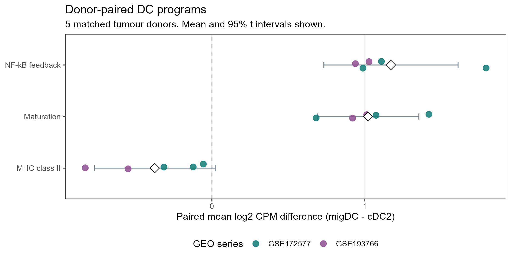
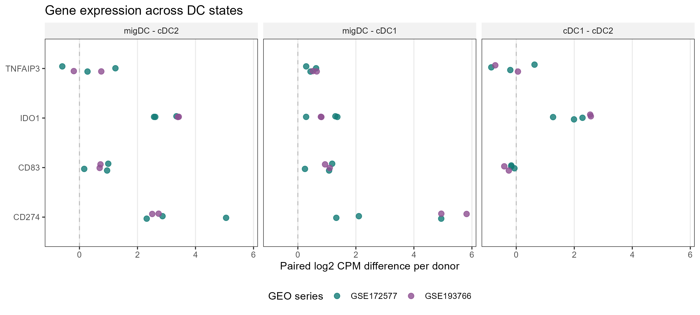

# Donor-paired transcriptional programs of migratory dendritic cells in oral squamous cell carcinoma

## Abstract

**Background**

Mature migratory dendritic cells (migDCs) have been described across solid tumours. Oral squamous cell carcinoma (OSCC) atlases offer a way to measure how consistently this state differs from conventional dendritic cell states within patients.

**Methods**

We revisited 10 single-cell libraries from eight donors in GSE172577 and GSE193766. We verified tissue assignment against GEO and compared tumour-derived migDCs with cDC2 using donor-paired pseudobulk models. We assessed donor leverage, cell-count support, normalisation, subtype assignment and matched cell subsampling. Program analyses excluded explicit subtype assignment genes.

**Results**

The discovery atlas retained 1,372 of 1,872 dendritic-cell candidates among 85,164 quality-controlled cells. Five patients had at least 10 migDCs and 10 cDC2s in the same tumour. Of 1,556 genes tested, 457 met the 5% false discovery rate. Fold-change ranks remained correlated after leaving out each donor (Spearman ρ 0.964–0.992). Maturation and NF-κB feedback program scores were higher in migDCs in all five patients. The exact sign-flip P value was 0.0625 for both programs. CAMERA identified relative enrichment of the broader Hallmark inflammatory response in cDC2 (FDR 0.042). *IDO1* was higher in both migDCs and cDC1s relative to cDC2. External metadata identified 688 author-annotated DCs across 10 eligible tumours.

**Conclusions**

Within the discovery cohort, maturation-associated expression and a subset of inflammatory feedback transcripts co-occurred in migDCs. The direction of inflammatory expression depended on the selected gene set and state comparator. Independent expression replication remains pending.

## Introduction

Analyses of tumour-associated dendritic cells have identified a migratory state with maturation-associated and immunoregulatory transcripts. Maier and colleagues described this program in lung tumours and identified expression across conventional DC lineages. Integrated head and neck atlases provide further context for cell-state heterogeneity and the relevance of anatomical site. These studies motivate testing how strongly the putative migratory program is reproduced in oral tumours within patients. [Maier et al.](https://pubmed.ncbi.nlm.nih.gov/32269339/) [HPV-negative head and neck atlas](https://doi.org/10.1038/s43856-026-01401-3)

We focused on three questions. Which migration-associated differences are supported by patient-paired expression? How sensitive are the effects to cell support, donor representation and marker-based reclassification? How do maturation, inflammatory feedback and a broader inflammatory program compare when the unit of inference is the patient? Replicate-aware differential expression is especially relevant for rare populations because many cells may come from a few patients. [Squair et al.](https://doi.org/10.1038/s41467-021-25960-2)

## Materials and methods

### Cohorts and atlas

The discovery atlas uses six primary oral-tongue tumours from GSE172577 and two tumour–adjacent tissue pairs from GSE193766. We verified library titles and tissue assignments against GEO before using accession-level joins. The preceding sample sheet had exchanged tumour and adjacent labels for both GSE193766 pairs. We used the prior atlas’s integer count snapshot and reviewed subtype assignments. The prior integration used library identifier for Harmony and the relabeling affected tissue-stratified analyses. [GSE172577](https://www.ncbi.nlm.nih.gov/geo/query/acc.cgi?acc=GSE172577) [GSE193766](https://www.ncbi.nlm.nih.gov/geo/query/acc.cgi?acc=GSE193766)

The atlas applies per-library QC, doublet removal, shared gene mapping, Leiden clustering and marker- plus reference-guided annotation. We defined the initial DC pool with both broad DC and plasmacytoid DC labels and used a second clustering and annotation pass. Candidate and retained DC fractions each use all QC-passing atlas cells as the denominator. Composition in two matched tumour–adjacent pairs is presented descriptively. [Detailed methods](../docs/methods.md) [Data provenance](../docs/data_provenance.md)

### Patient-paired expression and sensitivity analyses

We summed RNA counts from cells of the same subtype in each library. The primary comparison required a minimum of 10 cells for each of migDC and cDC2 in each patient's tumour. The edgeR model used gene expression filtering by subtype, TMM normalisation, a donor blocking term and a robust quasi-likelihood test. FDR was controlled across tested genes using Benjamini–Hochberg adjustment. The exploratory migDC–cDC1 and cDC1–cDC2 comparisons required at least five cells per state. All fitted comparisons used at least four donors. [edgeR](https://bioconductor.org/packages/edgeR)

We repeated the primary fit after removing each donor and with different minimum cell counts and TMMwsp normalisation. We assessed cell-number imbalance by repeated donor-matched equal-cell subsampling. An alternative annotation reassigned cells from the original conventional and migratory DC pool using the two-of-three detection rule. Cells meeting multiple gates or failing all gates were excluded from that fit. [Gate specification](../config/external_dc_gates.csv)

### Program and pathway analysis

Four expression programs represented maturation, NF-κB feedback, MHC class II and regulatory expression. Within each program, explicit assignment markers were excluded and at least 60% of targets had to pass the expression filter. We computed paired mean log₂ CPM differences and two-sided exact sign-flip P values. FDR adjustment covered the four defined programs. A separate CAMERA analysis used the primary paired design and the set of count-filtered genes after excluding explicit subtype assignment genes. It tested Hallmark sets with at least 10 measurable members. The default inter-gene correlation was 0.01. [Program gene lists](../config/dc_programs.csv) [CAMERA](https://pubmed.ncbi.nlm.nih.gov/22638577/)

### External validation protocol

We selected primary oral-cavity tumours from GSE181919 by source tissue and subsite labels. We inventoried the broad author DC class and fixed a three-gene gate for each conventional or migratory DC state. The validation script aligns raw UMI columns to barcode annotations and fits separate donor-paired models. It reports direction and rank concordance after excluding label-assignment genes and computes program scores on the genes supported in both series. The external UMI file was unavailable at this analysis stage. [GSE181919](https://www.ncbi.nlm.nih.gov/geo/query/acc.cgi?acc=GSE181919) [Choi et al.](https://pubmed.ncbi.nlm.nih.gov/36828832/)

## Results

### Discovery atlas and composition

We retained 85,164 atlas cells, of which 1,872 (2.20%) entered DC reclustering. Six retained states comprised 1,372 cells (1.61% of the atlas). Their counts were 124 cDC1, 310 cDC2, 286 Langerhans-like, 158 migDC, 355 pDC and 139 proliferating DC cells. After tissue-label correction and inclusion of the broad pDC label in the candidate pool, tumour-minus-adjacent retained-DC fractions were −1.94 and +1.37 percentage points in the two pairs. [Atlas and composition tables](../results/tables/09_dc_fraction_by_sample.csv)

### Donor-level differential expression

Five tumour donors contributed eligible paired samples. Among 1,556 tested genes, 246 were higher and 211 were lower in migDCs at FDR < 0.05. The migDC coefficient was +2.50 log₂ fold change for *LAMP3*, +5.56 for *CCL19*, +0.72 for *CD83* and +3.72 for *BIRC3*. The former two contributed to the prior state annotation. All four signs were retained after omission of each donor. [Primary differential expression](../results/tables/11_de_migDC_vs_cDC2.csv)

Effect-size ranks remained similar across each leave-one-donor-out fit (ρ 0.964–0.992 on shared tested genes). Relaxing the support threshold to three cells included seven patients and yielded ρ 0.979 relative to the main fit. Thresholds of 15 and 20 left three and two eligible donors. Four donors met the five-cell threshold with alternative marker-gate labels. Excluding assignment genes, the marker-gate fit reproduced the main fold-change ranks with ρ 0.946 across 1,526 shared genes. Three donors met the stricter 10-cell threshold under the alternative labels. [Threshold sensitivity](../results/tables/11_sensitivity.csv) [Marker-gate sensitivity](../results/tables/11_marker_gate_sensitivity.csv)

### Maturation, feedback expression and comparator effects

The mean paired differences in the maturation and NF-κB feedback panels were +1.02 and +1.17 log₂ CPM, respectively. Each direction was reproduced in all five donors and under 40 repeats of equal-cell subsampling. Five and six target genes met expression coverage in those panels, respectively. The exact two-sided P values were 0.0625, with FDR 0.083. The regulatory panel had insufficient expression coverage, with three of seven target genes available in the primary comparison. [Program effects](../results/tables/11_program_summary.csv) [Cell-balance sensitivity](../results/tables/11_balanced_cell_sensitivity.csv)

CAMERA detected relative enrichment of the Hallmark inflammatory response in cDC2 (FDR 0.042). The larger Hallmark TNF–NF-κB set had FDR 0.801. This panel dependence helps explain the divergent directions from the earlier cell-level pathway analyses. [Paired pathway results](../results/tables/11_paired_hallmark_camera.csv)

*IDO1* was higher in migDCs than cDC2 (log₂ fold change +3.21) and higher in cDC1 than cDC2 (+2.17). Given its prior use in state annotation, these data motivate a test of *IDO1* specificity using independently defined state labels. Gene detection by subtype and donor was recorded alongside pseudobulk fold changes. [Gene detection](../results/tables/11_gene_detection.csv) [Comparator estimates](../results/tables/11_panel_model_results.csv)

### External cohort inventory

GSE181919 metadata identified 10 eligible primary oral-cavity tumours from separate donors. The author annotations encompassed 10,397 cells and 688 broad DCs in these specimens. The next validation stage requires UMI counts to determine subtype support, expression direction and cross-cohort concordance. [External inventory](../results/tables/12_cohort_inventory.csv)

## Discussion

Patient pairing addresses variation that can be masked by single-cell tests across pooled donors. The observed directions support a maturation-associated transcriptomic contrast in OSCC and show that a selected feedback panel can rise while a broader inflammatory set is higher in cDC2. These results sharpen the expression claim that can be made from this atlas. Independent replication is required to estimate its generality across oral tumours.

Important limitations include the five-donor primary analysis, retrospective subtype definition and the smaller eligible counts under conservative cell thresholds and alternative annotation. Shared markers and a common expression matrix induce dependence between annotation and expression analysis. Excluding listed markers from program and pathway tests mitigates direct reuse. Other correlated genes can still retain a selection effect. The available counts estimate relative RNA abundance. Functional immunoregulation, protein activity, lineage direction and tissue-level abundance require independent assays or study designs. The two adjacent pairs provide descriptive composition evidence.

## Data and code availability

Discovery and candidate validation studies are publicly deposited under [GSE172577](https://www.ncbi.nlm.nih.gov/geo/query/acc.cgi?acc=GSE172577), [GSE193766](https://www.ncbi.nlm.nih.gov/geo/query/acc.cgi?acc=GSE193766) and [GSE181919](https://www.ncbi.nlm.nih.gov/geo/query/acc.cgi?acc=GSE181919). Project code, configuration, relevant software versions, donor-subtype aggregates and analysis tables accompany this draft. The main fit can be reproduced with `Rscript R/verify_primary.R`. [Project overview](../README.md)
