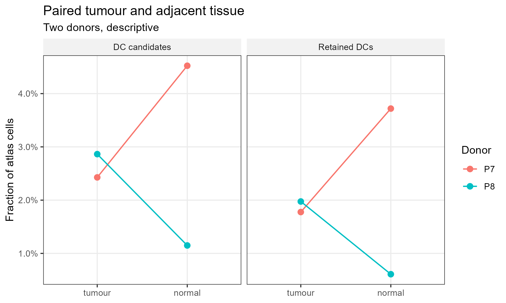
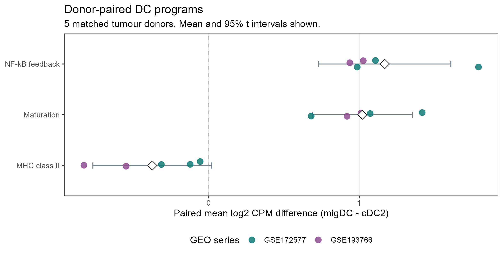

# 口腔鳞癌树突状细胞的患者配对转录分析

## 结果摘要

发现图谱有 8 位患者、10 个文库和 85,164 个通过质控的细胞。1,872 个 DC 候选细胞占图谱的 2.20%。排除两个低复杂度或混合信号簇后，保留 1,372 个 DC，占图谱的 1.61%。

主分析比较同一原发肿瘤里的迁移型 DC（migDC）和 cDC2。5 位患者的两类细胞均达到每类至少 10 个的门槛。将同一患者同类细胞的整数 UMI 加总后，用 edgeR 配对模型检验 1,556 个基因。457 个达到 FDR < 0.05，其中 246 个在 migDC 中较高，211 个在 cDC2 中较高。结果可从仓库中的汇总计数独立复算。[主分析表](../results/tables/11_de_migDC_vs_cDC2.csv)

## 1. 图谱与组织标签核查

| DC 亚型 | 保留细胞数 |
|---|---:|
| cDC1 | 124 |
| cDC2 | 310 |
| LC-like | 286 |
| migDC | 158 |
| pDC | 355 |
| 增殖型 DC | 139 |
| 合计 | 1,372 |

[GSE193766 的 GEO 原始记录](https://www.ncbi.nlm.nih.gov/geo/query/acc.cgi?acc=GSE193766)中，GSM5820668、GSM5820670 为癌旁组织，GSM5820669、GSM5820671 为对应肿瘤。原图谱在两对中均颠倒了组织标签。旧组成表还遗漏了主注释中独立标为 pDC 的细胞。新结果用同一候选 DC 定义重算分型前比例，并另报告排除低质量簇后的比例。[样本清单](../config/samples.csv)

两位患者保留 DC 的肿瘤减癌旁比例差分别为 −1.94 和 +1.37 个百分点，差值方向不同。这里只有两个配对样本，结果按患者展示。[配对组织结果](../results/tables/09_paired_tissue_descriptive.csv)

## 2. 基因结果与稳健性

同一患者内比较控制不同患者的整体表达差异。主模型估计的 log₂ fold change 代表 migDC 相对 cDC2 的表达差异。

| 基因 | log₂ fold change | FDR | 解读 |
|---|---:|---:|---|
| *LAMP3* | +2.50 | 1.38 × 10⁻⁴ | 亚型注释基因 |
| *CCL19* | +5.56 | 8.11 × 10⁻⁶ | 亚型注释基因 |
| *CD83* | +0.72 | 0.0072 | 未用于焦点亚型注释的成熟相关基因 |
| *BIRC3* | +3.72 | 4.49 × 10⁻⁵ | NF-κB 反馈相关基因 |
| *IDO1* | +3.21 | 6.26 × 10⁻⁶ | cDC1 与 migDC 均高于 cDC2 |
| *CLEC10A* | −5.51 | 5.09 × 10⁻⁶ | cDC2 注释基因 |

- 逐次移除一位患者重新拟合，共做 5 次。与主结果的共同基因 log₂ fold change 排名相关为 ρ = 0.964–0.992，上表 6 个基因的方向每次相同。[逐患者剔除](../results/tables/11_leave_one_donor_out.csv)
- 将两类细胞门槛从 10 个降至 3 个，纳入 7 位患者，共同基因排名仍相关（ρ = 0.979）。门槛升至 15 和 20 个时只剩 3 和 2 位患者，记录纳入数。替换 TMM 为 TMMwsp，454 个基因达到 FDR < 0.05。[细胞门槛与归一化](../results/tables/11_sensitivity.csv)
- 按患者把两种亚型的细胞数抽到一样，重复 40 次。成熟和 NF-κB 反馈基因组的平均差值在 40 次中均为正。[等量抽样](../results/tables/11_balanced_cell_sensitivity.csv)
- 对已注释的传统型和迁移型 DC 重新使用三基因规则分型。每类至少 5 个细胞时有 4 位配对患者，共同基因在排除分型基因后与主模型相关（ρ = 0.946）。每类至少 10 个细胞时只有 3 位患者。[亚型注释敏感性](../results/tables/11_marker_gate_sensitivity.csv)

原图谱的 1,340 个细胞级 Wilcoxon 差异基因用于描述亚群表达。两种分析的组织纳入、重复单位和基因过滤均不同。患者级主结果以本次配对模型为准。

## 3. 成熟、炎症和调节相关信号

成熟基因组和 NF-κB 反馈基因组都排除了用于焦点分型的基因。migDC 相比 cDC2 的平均配对差分别为 +1.02 和 +1.17 log₂ CPM，两个基因组均在 5 位患者中方向为正。精确符号置换的双侧 P 均为 0.0625，FDR 均为 0.083。独立检验该方向需要更多患者。[表达程序汇总](../results/tables/11_program_summary.csv)

在排除分型基因的患者配对 CAMERA 分析中，Hallmark 炎症反应基因集偏向 cDC2（FDR = 0.042）。较广的 TNF–NF-κB 基因集 FDR 为 0.801。局部反馈基因的改变和整个通路的活性需要分别评估。预定义的免疫调节基因组仅 3 个基因达表达过滤条件（7 个目标），证据不足以计算完整基因组效应。[通路与方向](../results/tables/11_paired_hallmark_camera.csv)

*IDO1* 在 migDC 和 cDC1 中相对 cDC2 的效应分别为 +3.21 和 +2.17 log₂ fold change。该基因也参与了原亚型注释，适合提出跨亚型表达特异性的假设。IDO1 蛋白活性与色氨酸通量需要独立证据。[亚型对照](../results/figures/11_dc_lineage_comparators.png)

## 4. 外部证据和论文进度

Choi 等的 GSE181919 原作者注释中，符合原发口腔肿瘤条件的有 10 位患者、10,397 个细胞，其中有 688 个作者标为 DC 的细胞。已核实公开元数据并编写外部流程。真实 UMI 计数矩阵的下载未完成，外部亚型分布及表达效应仍待计算。[外部样本清单](../results/tables/12_cohort_inventory.csv) [外部数据集](https://www.ncbi.nlm.nih.gov/geo/query/acc.cgi?acc=GSE181919)

本轮把论文主问题收敛到“主要表达差异在患者间是否可重现，以及差异是否依赖比较的 DC 亚型”。已有证据适合支持发现队列结果和可复现的方法段落。外部表达复现、样本量与独立功能证据决定稿件可支持的结论范围。旧拟时序和细胞级富集仍可作为补充探索，分化方向及因果作用需要独立研究设计。[英文论文草稿](manuscript.md)
