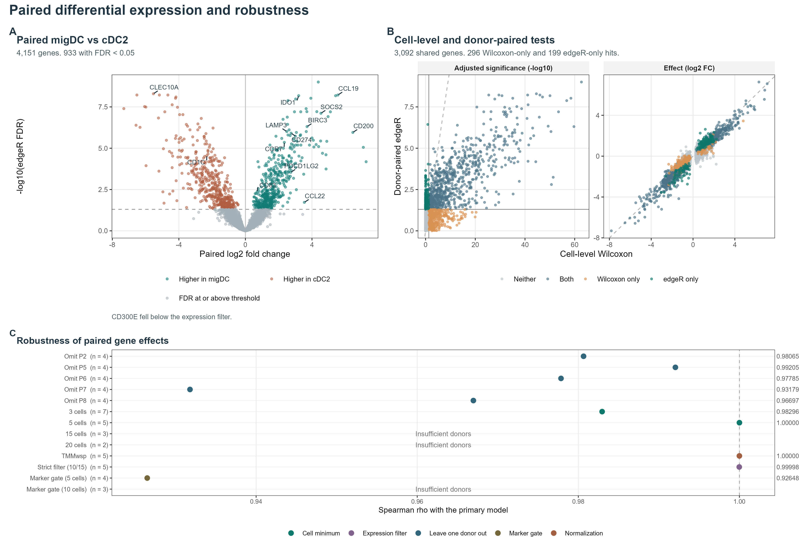
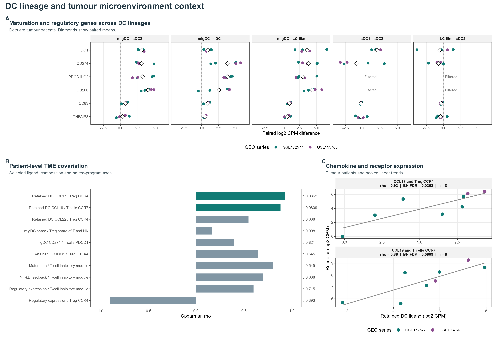

# 口腔鳞癌迁移型树突状细胞的患者配对转录分析

发现队列主模型在 5 位原发肿瘤患者中比较 migDC 与 cDC2，检验 4,151 个基因，其中 933 个 FDR < 0.05。4 个排除分型基因的表达程序均可估计。成熟、NF-κB 反馈和免疫调节程序在 migDC 中升高，广义 Hallmark 炎症反应则偏向 cDC2。GSE181919 的原始 UMI 计数在回收粗粒度髓系簇中的 cDC2 后复现了前三个程序的方向。 [主模型](../results/tables/11_sensitivity.csv) · [程序统计](../results/tables/11_program_summary.csv) · [CAMERA](../results/tables/11_paired_hallmark_camera.csv) · [双队列联合](../results/tables/12_combined_program_summary.csv)

## 1. 发现图谱与配对组织组成

发现图谱包含 8 位患者的 10 个文库，85,164 个通过质控的细胞分属 24 类主注释。DC 候选池有 1,872 个细胞，占全图谱 2.20%。亚群复核后保留 1,372 个 DC，占 1.61%。各亚型的细胞数见下表。 [主细胞注释](../results/tables/03_celltype_by_sample.csv) · [文库构成](../results/tables/09_dc_fraction_by_sample.csv) · [DC 亚型汇总](../results/tables/09_dc_subtype_pooled.csv)

| 保留 DC 亚型 | 细胞数 |
|---|---:|
| cDC1 | 124 |
| cDC2 | 310 |
| LC-like | 286 |
| migDC | 158 |
| pDC | 355 |
| 增殖型 DC | 139 |
| 合计 | 1,372 |

LC-like 表达 *CD207*、*CD1A* 和 *CD1E*，占保留 DC 的 20.8%。GSE193766 的组织标签按 GEO 文库编号纠正。P7 和 P8 两对组织中，保留 DC 占全图谱的肿瘤减癌旁差值分别为 −1.94 和 +1.37 个百分点。两对结果用于描述患者内构成。 [亚型汇总](../results/tables/09_dc_subtype_pooled.csv) · [配对结果](../results/tables/09_paired_tissue_descriptive.csv) · [数据溯源](../docs/data_provenance.md)

## 2. 患者内差异表达与稳健性

主模型要求每位患者的同一原发肿瘤里 migDC 和 cDC2 各至少 10 个细胞。聚合 RNA 层的整数 UMI 后，在亚型分组表达过滤中使用 `min.count = 3` 和 `min.total.count = 10`，再用 TMM 归一化及含患者阻断项的 edgeR 准似然模型。*PDCD1LG2* 和 *CD200* 均获得有效估计，migDC 相对 cDC2 的 log₂ fold change 分别为 +2.73 和 +6.46，FDR 分别为 2.88 × 10⁻⁴ 和 1.11 × 10⁻⁶。 [主差异表达](../results/tables/11_de_migDC_vs_cDC2.csv) · [基因面板估计](../results/tables/11_panel_model_results.csv) · [过滤参数](../results/tables/11_sensitivity.csv)

- 有 3,092 个基因在细胞级 Wilcoxon 与患者配对 edgeR 中均有估计。其中 296 个仅在 Wilcoxon 中达到对应校正阈值，199 个仅在 edgeR 中达到。患者配对结果用于跨患者推断。 [两种方法的基因级数据](../results/tables/11_de_migDC_vs_cDC2.csv)
- 逐一移除患者重拟合，共享基因与主模型的效应秩相关为 ρ = 0.932–0.992。3 细胞门槛纳入 7 位患者，ρ = 0.983。5 细胞门槛保留主模型的 5 位患者。15 和 20 细胞门槛分别有 3 位和 2 位达标，低于拟合下限。TMMwsp 与严格表达过滤 `strict_filter_min10`（10/15）各自与主模型的 ρ 均高于 0.9999。 [逐患者剔除](../results/tables/11_leave_one_donor_out.csv) · [敏感性结果](../results/tables/11_sensitivity.csv)
- 按固定三基因面板重新分型，每类要求至少检出 2 个面板基因且只通过一个门。5 细胞门槛下可拟合 4 位患者，排除分型基因后与主模型的 ρ = 0.926。10 细胞门槛下有 3 位达标。 [门控基因](../config/external_dc_gates.csv) · [重分型敏感性](../results/tables/11_marker_gate_sensitivity.csv)

## 3. 表达程序与炎症方向

目标基因达到 60% 覆盖才计算患者内程序均值。效应为 migDC 减 cDC2 的配对 log₂ CPM 差。三项正向程序在 5/5 位患者和 40/40 次等量抽样中均为正。主模型四项程序的双侧精确符号翻转 P 均为 0.0625。配对 *t* 检验和定向 fry 检验进一步支持三项正向程序。MHC II 定向证据较弱，其混合方向 fry FDR 为 0.0262。 [程序汇总](../results/tables/11_program_summary.csv) · [fry 结果](../results/tables/11_program_fry.csv) · [等量抽样](../results/tables/11_balanced_cell_sensitivity.csv)

| 表达程序 | 覆盖基因 | 平均配对差（log₂ CPM） | 配对 *t* P | 配对 *t* FDR | 定向 fry FDR |
|---|---:|---:|---:|---:|---:|
| Maturation（成熟） | 5/6 | +1.01 | 0.00116 | 0.00232 | 0.00228 |
| NF-kB feedback（NF-κB 反馈） | 7/7 | +1.06 | 0.0230 | 0.0306 | 0.0263 |
| Regulatory expression（免疫调节表达） | 6/7 | +2.74 | 4.27 × 10⁻⁵ | 1.71 × 10⁻⁴ | 9.60 × 10⁻⁵ |
| MHC class II（MHC II） | 8/8 | −0.39 | 0.0571 | 0.0571 | 0.0626 |

固定门控不含 *CD274* 和 *IDO1*。在该分型下，把两基因纳入 Regulatory expression (incl. CD274/IDO1)，得到 7/9 个基因覆盖，4/4 位患者同向，平均差 +4.08 log₂ CPM，配对 *t* P = 1.90 × 10⁻⁴，定向 fry FDR = 6.11 × 10⁻⁴。 [门控程序结果](../results/tables/11_marker_gate_programs.csv)

排除分型基因的配对 CAMERA 显示，广义 Hallmark 炎症反应（q = 0.00671）与移植物排斥（q = 0.0129）偏向 cDC2，TNF signalling via NF-κB 的整体方向证据较弱（q = 0.602）。migDC 的 *BIRC3*、*RELB*、*NFKBIA*、*TNFAIP3*、*TRAF1*、*TNIP1* 指向反馈与存活相关表达，cDC2 的 *OLR1*、*CLEC10A* 和其他髓系感知相关基因呈相反方向。图 3C 中 *TREM1*、*CD300E*、*THBS1*、*F13A1* 的配对变化来自原始聚合计数的描述性展示。 [CAMERA 结果](../results/tables/11_paired_hallmark_camera.csv) · [主基因结果](../results/tables/11_de_migDC_vs_cDC2.csv)

## 4. LC-like 谱系对照与肿瘤微环境

五项谱系对比各有 5 位配对患者。migDC–LC-like 和 LC-like–cDC2 分别检验 5,873 和 6,626 个基因。相较 cDC2，*IDO1* 在 migDC 和 cDC1 中的 log₂ fold change 分别为 +3.20 和 +2.15。migDC 比 LC-like 高 +2.96，而 LC-like 比 cDC2 为 +0.24（FDR = 0.752）。*CD274*、*PDCD1LG2*、*CD200* 和 *SOCS2* 在 migDC 中相较上述三个对照均升高。*CD274* 与 *IDO1* 参与原始 migDC 注释，解释时结合排除这两基因的客观门控。 [谱系模型面板](../results/tables/11_panel_model_results.csv) · [各对比纳入与检验数](../results/tables/11_sensitivity.csv) · [migDC–LC-like](../results/tables/11_de_migDC_vs_LClike.csv) · [LC-like–cDC2](../results/tables/11_de_LClike_vs_cDC2.csv)

在 Stage 13 的 8 个原发肿瘤中，保留 DC 的 *CCL17* 与 Treg *CCR4* 共变（Spearman ρ = 0.93，P = 8.63 × 10⁻⁴，FDR = 0.0362），是 42 个可检验互作轴中唯一达到 5% FDR 的结果。保留 DC *CCL19* 与 T 细胞 *CCR7* 呈同向相关（ρ = 0.88，FDR = 0.0809）。migDC 占保留 DC 的比例与 Treg 占 T/NK 的比例相关较弱（ρ = 0.17，FDR = 0.998）。另有 4 条涉及 3 细胞敏感性免疫调节程序的轴因覆盖不足保留为缺失。 [组成](../results/tables/13_tme_cell_proportions.csv) · [患者谱](../results/tables/13_tme_donor_profiles.csv) · [共变统计](../results/tables/13_tme_ligand_receptor_correlations.csv)

## 5. 独立外部验证与跨队列联合

GSE181919 有 10 位入选口腔癌患者、10,397 个采集细胞。原始 UMI 中提取 2,902 个髓系 APC，其中 688 个属于作者 `Dendritic.cells`、2,214 个属于 `Macrophages`。符合 cDC2 门控的 245 个细胞中有 243 个（99.2%）在 `Macrophages`。作者 `Dendritic.cells` 中有 209 个 migDC、52 个 cDC1 和 2 个 cDC2。仅使用作者 DC 类别时，两个门槛下均无达标 migDC–cDC2 配对。 [真实输入](../results/tables/12_inputs.csv) · [样本清单](../results/tables/12_cohort_inventory.csv) · [注释粒度审计](../results/tables/12_classification.csv)

跨队列 ρ 使用所有共享且可检验的非分型基因，同向率的分母是其中在发现队列达到 FDR < 0.05 的基因。混合对照将 migDC 限于原作者 DC 类别，cDC2 来自同一队列中 *CD163* 检出为零的髓系 APC。 [各模型与匹配统计](../results/tables/12_cross_cohort_summary.csv)

| 外部 migDC–cDC2 模型 | 配对患者 | 共享基因 Spearman ρ | 共享发现显著基因同向率 |
|---|---:|---:|---:|
| 髓系 APC 池，每类至少 10 个 | 6 | 0.671 | 93.4% |
| 髓系 APC 池，每类至少 5 个 | 7 | 0.679 | 94.8% |
| CD163 检出为零，每类至少 10 个 | 4 | 0.680 | 94.5% |
| CD163 检出为零，每类至少 5 个 | 7 | 0.700 | 95.0% |
| 作者 migDC 与 CD163 检出为零的 cDC2，每类至少 10 个 | 4 | 0.751 | 96.8% |

外部主模型的成熟、NF-κB 反馈和免疫调节程序在 6/6 位患者中为正，平均效应分别为 +0.98、+0.67、+1.52 log₂ CPM，定向 fry FDR 均 < 0.05。外部扩展调节面板平均 +1.92 log₂ CPM，配对 *t* P = 2.33 × 10⁻⁴，fry FDR = 4.59 × 10⁻⁴。 [外部程序](../results/tables/12_program_summary.csv)

在每个模型共享的基因上重算两队列得分后，前三个正向程序在 10 细胞主模型为 11/11 同向，在两个 5 细胞模型各为 12/12 同向。三个程序的联合双侧符号翻转 P 在主模型和 5 细胞模型分别为 9.77 × 10⁻⁴ 和 4.88 × 10⁻⁴。主联合模型的三个配对 *t* P 依次为 3.48 × 10⁻⁶、2.48 × 10⁻⁴、2.00 × 10⁻⁶，Fisher fry FDR 依次为 1.24 × 10⁻⁴、7.79 × 10⁻⁴、3.57 × 10⁻⁷。 [共享程序得分](../results/tables/12_shared_program_donor_effects.csv) · [联合统计](../results/tables/12_combined_program_summary.csv)

## 证据边界与复现

迁移 DC 的 NF-κB 反馈表达和 cDC2 的广义髓系炎症富集描述不同层次的转录信号。*IDO1* 的共享高表达与 migDC 相对其他亚型的免疫调节配体富集也应分别解读。TME 结果来自患者间共变，CD163 阴性指零 UMI 检出。发现队列只有 5 位主模型患者及两对癌旁组织，分析未纳入统一临床分期或生存随访。RNA 数据能界定表达状态和关联，蛋白功能、组织空间接触、趋化因果及分化方向需要独立证据。 [英文论文](manuscript.md) · [详细方法](../docs/methods.md)

从仓库根目录运行。主模型复算使用已保存的汇总计数。完整重跑需要已审核的图谱对象和 GSE181919 两份原始补充文件。阶段 13 重算 TME，阶段 14 生成五张主图，`verify_all` 调用 `R/99_verify_all.R` 审计数据、图件和文档链接。 [数据准备](../data/README.md) · [主模型复算](../R/verify_primary.R) · [TME 脚本](../R/13_tme_covariation.R) · [主图脚本](../R/14_manuscript_figures.R) · [全链路审计](../R/99_verify_all.R)

~~~bash
Rscript R/verify_primary.R
./run_all.sh 09 11 12 13 14 verify_all
Rscript R/99_verify_all.R
~~~
