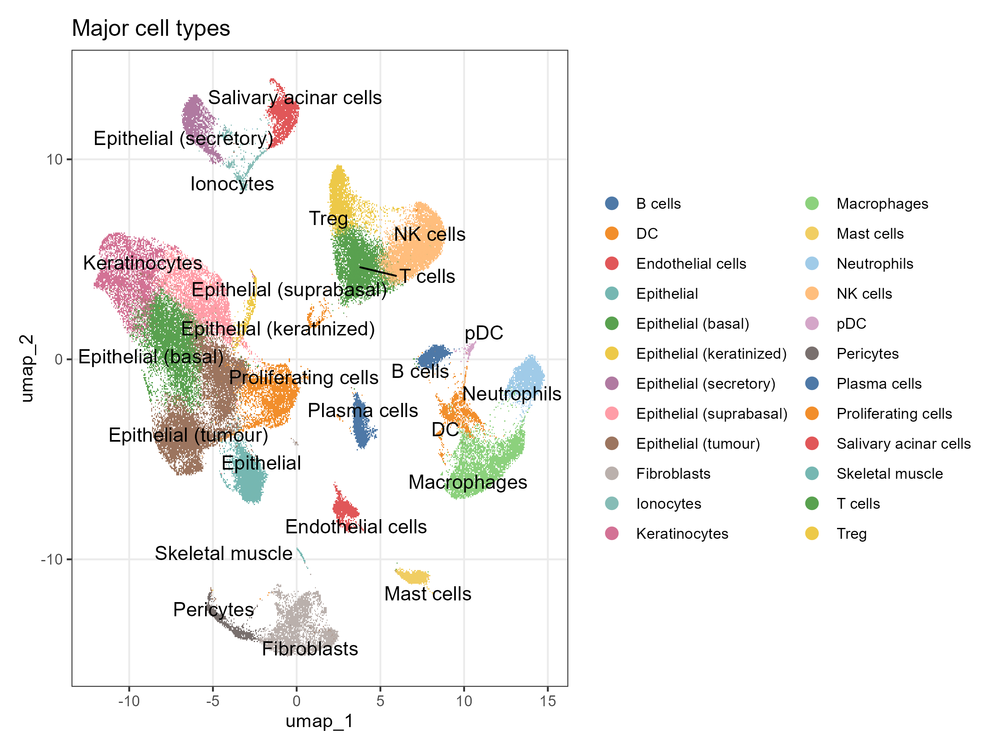
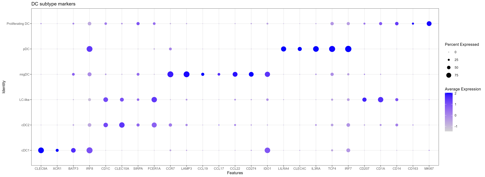
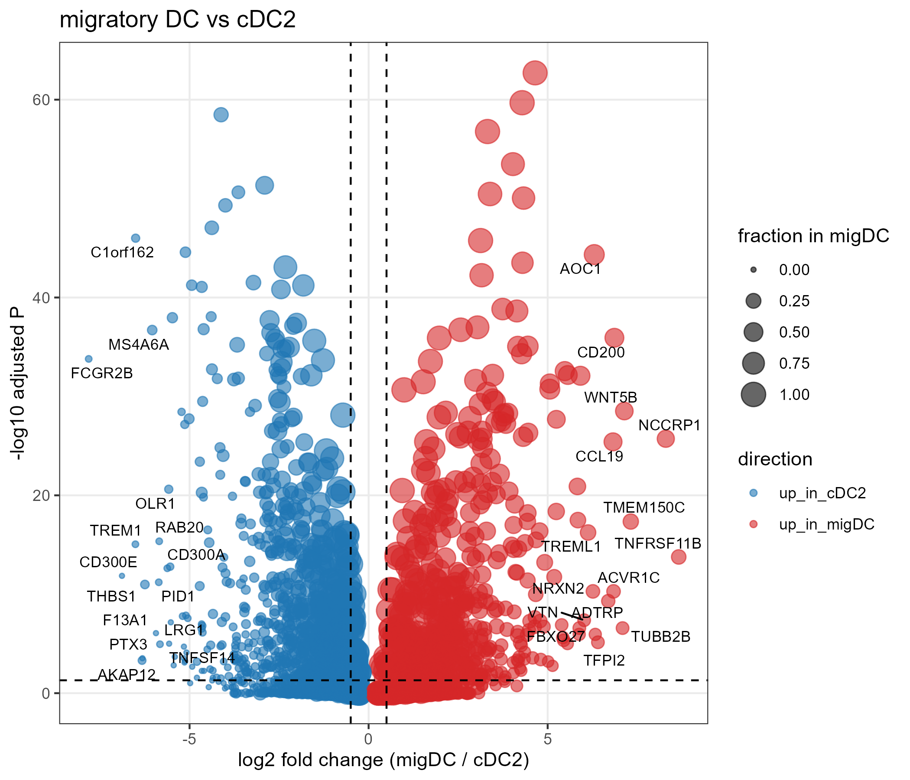
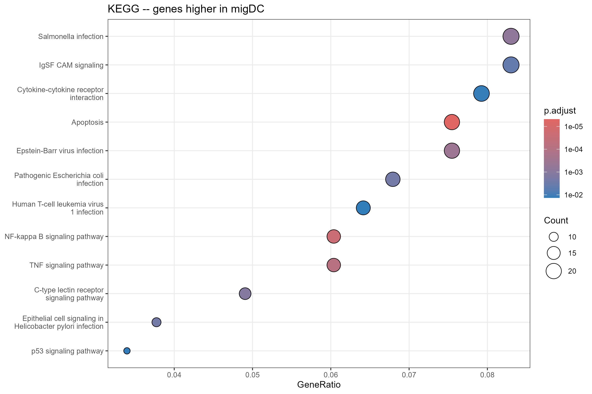
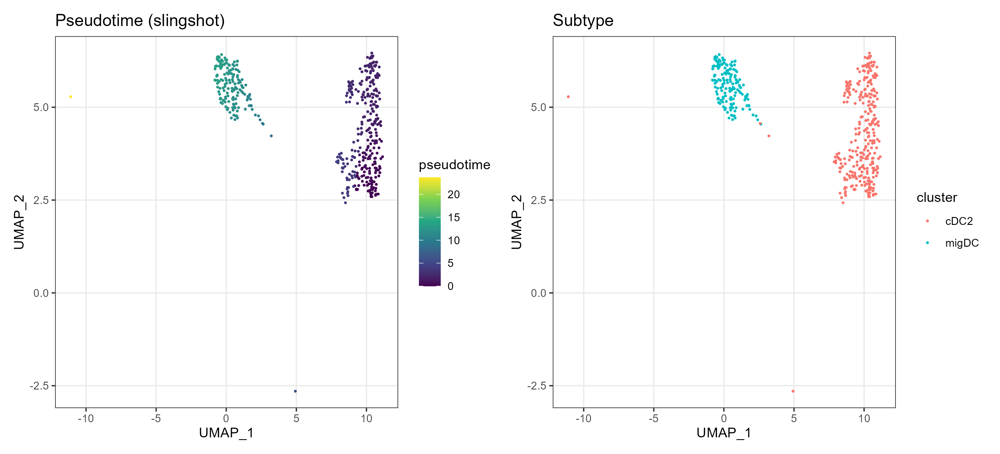
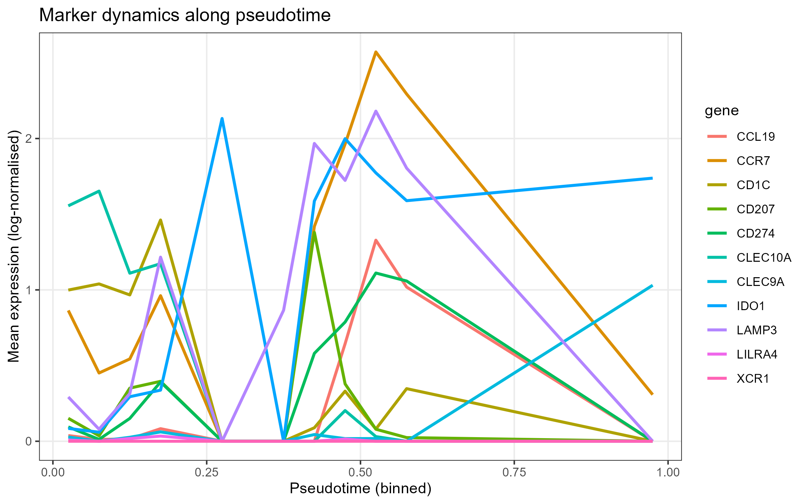
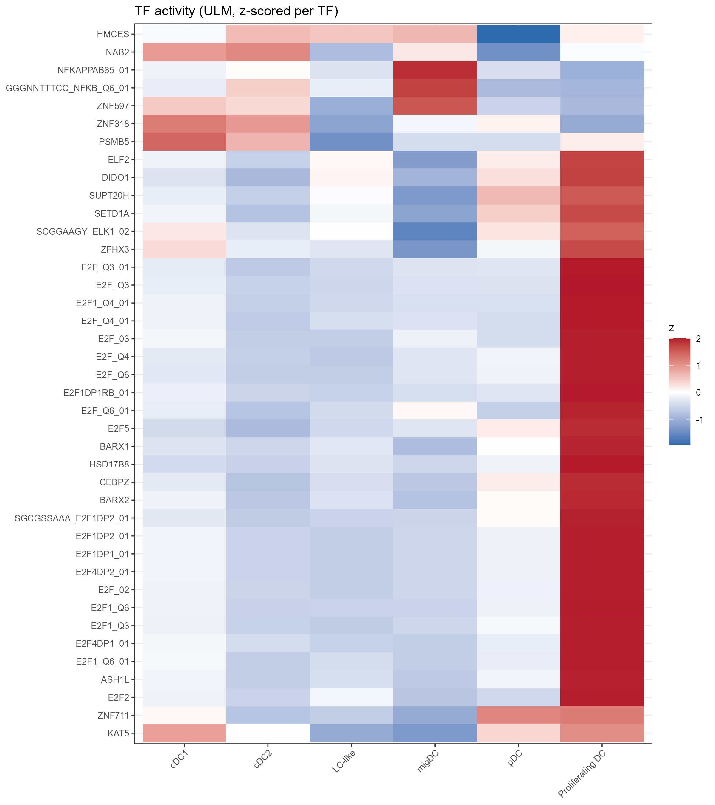
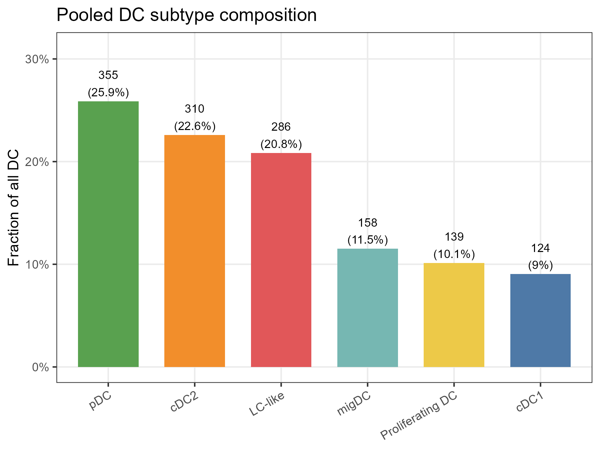

# 口腔鳞癌树突状细胞单细胞图谱：重建与再分析

**A reproducible single-cell atlas of dendritic cells in oral squamous cell carcinoma**

2026 年 11 月 · 代码与结果：[`oscc-dc-atlas`](../README.md)

---

## 摘要

**背景**：口腔鳞状细胞癌（OSCC）免疫治疗响应率低，树突状细胞（DC）是连接先天与适应性免疫的枢纽。
一份既有的分析曾整合两套公开 scRNA-seq 数据，报告了 5 个 DC 亚群及"cDC2 → 迁移型 DC"的分化轨迹；
但该分析的脚本无法端到端复现，注释与富集环节存在方法学缺陷。

**方法**：从 GEO 重新获取 10 个 10x 文库的原始 UMI 计数（8 例患者，2 例含配对癌旁），
经统一 QC（绝对阈值 + 样本内自适应上界）、scDblFinder 去双细胞后，用 Harmony 去批次、
Leiden 聚类、三级证据注释（3 个参考集 + cluster marker + 人工裁决表）构建图谱；
随后对 DC 进行亚群重聚类、方向敏感的差异表达与富集分析、slingshot 拟时序与 decoupleR TF 活性分析。

**结果**：85,164 个细胞通过质控，注释为 24 个细胞类型；DC 共 1,872 个（2.2%）。
DC 亚群重聚类得到 6 个可解释亚型——cDC1（124）、cDC2（310）、LC-like（286）、
迁移型 DC/mregDC（158）、pDC（355）、增殖型 DC（139），另有 500 个低质量/环境 RNA 污染的细胞被排除。
cDC2 与迁移型 DC 之间有 1,340 个差异基因（BH p < 0.05），
迁移型 DC 上调 *CCR7*、*LAMP3*、*CCL19*、*CCL22*、*CD274*、*IDO1*，
cDC2 上调 *CD1C*、*CLEC10A*、*CD300E*、*FOXO1*、*STAT4* 等。
富集分析显示 cDC2 偏向吞噬体/结核病/髓系活化，迁移型 DC 偏向 NF-κB/TNF/凋亡相关通路；
NF-κB 活性在迁移型 DC 中最高，E2F 家族在增殖型 DC 中最高（方法学阳性对照）。

**结论**：本数据支持"cDC2 → 迁移型 DC/mregDC"作为一条**转录成熟轴**，
并复现了原分析关于 cDC2 富集吞噬体/结核病通路的观察；
但数据不支持"CLEC10A 经 IDO1 重塑色氨酸代谢"等原分析的机制推论，也未观察到稳定的肿瘤-癌旁 DC 差异（仅 2 对配对样本）。

---

## 1. 研究问题

1. 在两套公开 OSCC 数据中，能否稳定地重建出可解释的 DC 亚群？
2. 原分析提出的"cDC2 → 迁移型 DC"轨迹，在更严格的流程下是否依然成立？
3. 两个亚群在转录程序、通路与转录因子活性上有何差异？
4. 肿瘤与癌旁组织的 DC 组成是否存在差异（在样本量允许的范围内）？

---

## 2. 数据

| GEO | 文库 | 患者 | 组织 | 原文主题 |
|---|---|---|---|---|
| GSE172577 | 6 | P1–P6 | 舌部 OSCC 原发灶 | TCF7⁺ T 细胞 / TLS（PMID 34044317） |
| GSE193766 | 4 | P7、P8 | 肿瘤 + 配对癌旁 | γδT17 / c-Maf（PMID 35613277） |

**注意**：两套数据都不是为 DC 设计的，DC 仅占 1.8%–2.2%，这决定了所有 DC 结论都是探索性的。
数据细节、文件取舍与校验和见 [`docs/data_provenance.md`](../docs/data_provenance.md)。

---

## 3. 流程概览

```
原始 UMI → QC → 去双细胞 → Harmony → Leiden(0.5) → 25 群 → 24 类细胞
        → DC 子集(1,872) → 重聚类(8 群) → 6 亚型 + 2 低质量簇
        → 差异表达 → GO/KEGG(分方向) + GSEA → 拟时序 → TF 活性 → 组成
```

全部参数集中在 `R/00_setup.R`，方法细节与选择理由见 [`docs/methods.md`](../docs/methods.md)。

### 3.1 质控

| 阶段 | 细胞数 | 说明 |
|---|---|---|
| Cell Ranger 产出 barcode | 113,448 | 10 个文库 |
| 数据提供方 QC 后 | 108,569 | GEO 附件中的对象 |
| 本流程 QC 后 | 95,328 | 去除 13,241（12.2%）：低复杂度/高线粒体/红细胞 |
| 去双细胞后 | **85,164** | scDblFinder 去除 10,164（10.7%） |

每个样本的细胞数、中位基因数、线粒体比例见 `results/tables/01_sample_qc.csv`；
QC 阈值与分布见 `results/figures/10_qc_*.png`。

### 3.2 图谱

25 个 Leiden 群（resolution 0.5）注释为 24 个细胞类型，
包括上皮（肿瘤/基底/棘层/分泌型/角化）、角蛋白细胞、唾液腺腺泡与离子细胞、
T/Treg/NK、B/浆细胞、巨噬细胞、DC/pDC、肥大细胞、中性粒细胞、成纤维细胞、内皮、周细胞、骨骼肌与增殖细胞。



*图 1. 85,164 个细胞的 UMAP 与主细胞类型注释。*

---

## 4. 结果

### 4.1 DC 的总体比例

DC（cluster 19）与 pDC（cluster 24）合计 **1,872 个细胞，占全部细胞的 2.2%**。
各文库的 DC 比例在 0.5%–3.3% 之间（`09_dc_fraction_by_sample.csv`）。

### 4.2 DC 亚群

对 1,872 个 DC 重新降维聚类得到 8 个簇，结合 marker 与参考集注释为 6 个亚型，
另 2 个簇（500 个细胞）中位基因数仅 478/1,154、且高表达 *KRT14*、*MUC7* 等上皮基因，
判定为低复杂度/环境 RNA 污染细胞，**不进入下游分析**。

| 亚型 | 细胞数 | 占比 | 核心 marker（% 表达） |
|---|---|---|---|
| pDC | 355 | 25.9% | *LILRA4* 78、*CLEC4C* 60、*IL3RA* 88、*TCF4* 94、*IRF7* 98 |
| cDC2 | 310 | 22.6% | *CD1C* 68、*CLEC10A* 84、*FCER1A* 77、*CD300E* 35 |
| LC-like | 286 | 20.8% | *CD207* 63、*CD1A* 82、*CD1E* 75、*FCGBP* 56 |
| migDC（mregDC） | 158 | 11.5% | *LAMP3* 91、*CCR7* 92、*CCL22* 74、*CD274* 73、*IDO1* 80 |
| Proliferating DC | 139 | 10.1% | *MKI67* 73、*TOP2A* 78 |
| cDC1 | 124 | 9.0% | *CLEC9A* 89、*XCR1* 42、*IDO1* 85 |



*图 2. DC 亚型的 marker 表达。*

> **比例不可过度解读**：pDC 占比 26% 明显高于组织中的常见比例，主要因为 pDC 在全局聚类中
> 独立成群、而 cDC1/cDC2/LC-like 共享一个群，聚类粒度会影响比例估计；且每个文库仅 30–296 个 DC。
> 因此本报告只使用**汇总比例**，不比较文库间比例。

### 4.3 cDC2 与迁移型 DC 的差异表达

在 RNA assay（log-normalized）上用 Wilcoxon 检验比较 migDC（158）与 cDC2（310）：
**1,340 个基因** BH 校正后显著（p_adj < 0.05），其中 1,282 个 |log2FC| ≥ 0.5——
**506 个在 migDC 中更高，776 个在 cDC2 中更高**。



*图 3. migDC vs cDC2 火山图。*

| 方向 | 代表基因 |
|---|---|
| migDC ↑ | *CCR7, LAMP3, CCL19, CCL22, CCL17, CD274, IDO1, CD200, AOC1, WNT5B, NCCRP1* |
| cDC2 ↑ | *CD1C, CLEC10A, FCER1A, CD300E, CD300A, TREM1, OLR1, THBS1, F13A1, AKR1C3, PTX3* |

这一格局与已发表的 mregDC/LAMP3⁺ DC 程序一致（Maier 2020 *Nature*；Zhang 2019 *Cell*）：
成熟迁移型 DC 上调趋化因子与共抑制分子，cDC2 保留抗原摄取与髓系活化程序。

### 4.4 通路富集：方向拆开后，原分析的观察部分被复现

**（a）过表达分析（ORA，分方向）**

- **cDC2 上调基因**（776 个）：吞噬体（*p* = 1.9e-10）、结核病（2.9e-12）、
  髓系白细胞活化、白细胞黏附、脂质与动脉粥样硬化、造血细胞谱系。
  → **与原分析"C2 富集结核病/吞噬体通路"一致**，且这一次是方向明确的。
- **migDC 上调基因**（506 个）：NF-κB 信号（2.2e-5）、TNF 信号（7.6e-5）、
  凋亡、C 型凝集素受体信号、细胞因子-细胞因子受体互作；
  GO 层面富集"免疫系统过程的负调控""外源性凋亡信号""T 细胞增殖的正调控"。



*图 4. migDC 上调基因的 KEGG 富集。*

**（b）GSEA（全基因排序，不做 fold-change 截断）**

Hallmark 集合中 8 条通路显著（padj < 0.05），**全部偏向 cDC2 一侧**：
INFLAMMATORY_RESPONSE（NES = −1.93）、TNFA_SIGNALING_VIA_NFKB（−1.52）、
MTORC1_SIGNALING（−1.59）、ALLOGRAFT_REJECTION、COMPLEMENT、KRAS_SIGNALING_UP/DN。

> **一个必须说明的矛盾**：ORA 说 NF-κB/TNF 通路在 migDC 上调基因中富集，
> GSEA 却说整体炎症/TNF-NF-κB 模块偏向 cDC2。两者并不冲突——
> ORA 只看"显著上调的那 506 个基因"，GSEA 看全基因排序；
> 单个 NF-κB 通路成员（如 *NFKBIA*、*TNFAIP3*、*BIRC3*）在 migDC 更高，
> 而整个炎症效应模块在 cDC2 更高。**只报其中一个就会得出相反结论**，
> 这也是原分析"合并双向基因做一张图"最容易出问题的地方。

### 4.5 拟时序：一条可复现的成熟轴

以 cDC2 为根、cDC2 + migDC 共 468 个细胞构建 slingshot 轨迹（根节点写在代码里，不再鼠标点选），
伪时间范围 0–23.7。沿伪时间：*CD1C*、*CLEC10A* 下降，*CCR7*、*LAMP3*、*CCL19*、*CD274*、*IDO1* 上升。



*图 5. slingshot 伪时间（左）与亚型（右）。*



*图 6. marker 基因沿伪时间的表达（20 个分箱的均值）。曲线在 0.4–0.5 处的跳变来自分箱边界与细胞数偏少，
不应解读为真实的表达波动；趋势方向与 `07_gene_pseudotime_correlation.csv` 的 Spearman ρ 一致。*

**解释边界**：伪时间是转录相似性的排序，不是分化证据。要证明"cDC2 分化为 migDC"，
需要 RNA velocity 或谱系追踪；本报告只表述为"沿成熟轴的转录连续谱"。

### 4.6 转录因子活性

用 MSigDB C3(TFT) 的 1,112 个调控子 × decoupleR ULM 打分：

- **NF-κB 家族**（NFKB_C 4.35 → migDC 5.71；NFKB_Q6_01 3.47 → 5.08）在 **migDC** 最高，
  与 4.4 的 NF-κB 通路结果方向一致；
- **E2F1** 在 **Proliferating DC** 中最高（5.7 vs 2.2–3.0）——方法学阳性对照成立；
- **IRF7**（3.06）与 **TCF4**（E2-2，相对最高）在 **pDC**，符合 pDC 的已知调控；
- **FOXO1/STAT4** 在 **cDC2** 较高。



*图 7. 各亚型中变异最大的 40 个调控子的活性（按 TF z-score）。*

> C3(TFT) 中包含部分非转录因子或低特异性 motif 条目（如 *HSD17B8*），
> 因此只解读有明确生物学预期的调控子，其余仅作为探索线索。

### 4.7 组成：只做描述

汇总 1,372 个 DC 的亚型构成见 4.2。按文库拆分后，各亚型比例波动极大
（例如 GSM5258386 的 270 个 DC 中 172 个为 pDC，而 GSM5258385 的 30 个 DC 中 15 个为增殖型），
**在每文库 30–300 个细胞的量级下，这些差异无法与抽样噪声区分**。
肿瘤 vs 癌旁仅有 2 对配对样本（P7、P8），且方向相反（P7：3.3% vs 2.2%；P8：1.1% vs 2.7%），
因此**不做统计检验、不下结论**。



*图 8. 汇总的 DC 亚型构成。*

---

## 5. 与原分析的对照

| 原分析结论 | 本分析 | 判断 |
|---|---|---|
| DC 可分为 cDC1 / cDC2 / 迁移型 / pDC / CD207⁺ 五群 | 复现出 cDC1、cDC2、migDC、pDC；**CD207⁺ 细胞独立成群（LC-like，286 个）** | ✅ 支持，且更细 |
| C2(cDC2) 占多数 | 本数据中 pDC 最多（26%），cDC2 22.6% | ⚠️ 取决于聚类粒度与细胞来源，不宜下"多数"结论 |
| C2 富集结核病、吞噬体通路 | 方向拆分后，cDC2 上调基因显著富集结核病（2.9e-12）、吞噬体（1.9e-10） | ✅ **复现** |
| C3 富集 NF-κB、TNF 通路 | ORA 支持（NF-κB 2.2e-5，TNF 7.6e-5）；GSEA 显示整体炎症模块偏向 cDC2 | ⚠️ 部分支持，需区分"通路基因"与"通路整体" |
| 拟时序证明 C2→C3 分化 | 伪时间轴存在，marker 梯度方向一致 | ⚠️ 降级为"转录连续谱" |
| RACK1 + ATP 合酶驱动迁移能量供给 | **无法评估**：*RACK1* 与 *ATP5F1E/ATP5MG/ATP5MC2* 均不在 GSE172577 的 22,161 个特征内，合并矩阵取交集后不含这些基因 | ❌ 无法复核（见 §7） |
| CLEC10A → IDO1 → 色氨酸代谢 | *IDO1* 在 cDC1（85%）与 migDC（80%）最高，**cDC2 仅 11%**；方向与原假设相反 | ❌ **不支持** |

---

## 6. 结论

1. 在 85,164 个细胞中，DC 占 2.2%，可分为 6 个可解释亚型；cDC1 仅 124 个细胞，提示该队列中 cDC1 稀少。
2. cDC2 与迁移型 DC 之间存在大规模转录差异（1,340 个基因），构成一条以 *CCR7/LAMP3/CCL19* 上调、
   *CD1C/CLEC10A* 下调为标志的成熟轴，NF-κB 活性沿该轴升高。
3. 原分析关于 cDC2 富集吞噬体/结核病通路的观察可以被复现；
   但"CLEC10A–IDO1–色氨酸代谢"的机制假设与数据方向相反，应予放弃。
4. 由于每文库 DC 数量少、癌旁样本仅 2 例，**本数据不足以支持任何患者水平或预后层面的推断**。

---

## 7. 局限

最关键的四条：

- 数据不是为 DC 设计的，稀有亚群细胞数少（cDC1 = 124）；
- **两个数据集的特征集不对称**：GSE172577 只有 22,161 个 Ensembl ID（是 GSE193766 的 33,514 的子集），
  *RACK1*、*ATP5F1E/ATP5MG/ATP5MC2* 等基因不在其中；合并矩阵取交集（20,814 个符号），
  因此原分析的 RACK1/ATP 合酶模块在本项目中无法评估。若改用并集，这些基因在 GSE172577 中会被当成"0 表达"，
  反而引入偏差——这是取舍，不是遗漏。
- 细胞水平的差异分析会高估显著性，未做 pseudobulk；
- 伪时间不等于分化，TF 活性不等于 TF 蛋白活性。

---

## 8. 复现

```bash
make all          # 约 40 分钟（16 核 / 32 GB）
```

所有图（PNG 300 dpi + PDF）在 `results/figures/`，所有数字在 `results/tables/`，
软件版本见 [`docs/sessionInfo.txt`](../docs/sessionInfo.txt)。
